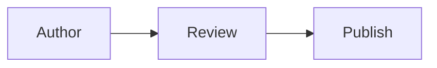

# Diagrams

> Documentation index: [llms.min.txt](https://www.shoalrun.com/llms.min.txt) · Document manifest: [documents.json](https://www.shoalrun.com/documents.json)

Navigation section: [Reference](https://www.shoalrun.com/.well-known/shoalrun/navigation/reference-tab-50f26fe22670.txt) (ID: reference-tab). [All sections and pages](https://www.shoalrun.com/llms.min.txt)

Breadcrumbs: [Reference](https://www.shoalrun.com/cli.md) > Components > Overview

**Updated: 2026-10-27.**

Use `<Diagram>` for flowcharts, sequence diagrams, charts, and other graphs written as text. D2 is the default engine, with TALA as its default layout. Set `engine="mermaid"` for Mermaid syntax, rendered by [Pele](https://pele.run). Diagrams render to SVG during the build, so readers do not need a diagram script in their browser. Set a literal pixel `width`, such as `width="440"`, to cap the diagram's displayed width while allowing it to shrink on narrow screens.

For the diagram languages themselves, use the official [D2 tour](https://d2lang.com/tour/intro/) and [Mermaid syntax reference](https://mermaid.js.org/intro/syntax-reference.html). Shoalrun's component controls how their source is published; those references cover each language's shapes, connections, and diagram types.

Every diagram needs a short `title` and `summary`. The summary states the point of the diagram; it does not need to repeat every connection. For a complex diagram, add a fuller explanation in nearby prose so readers can understand its meaning without the graphic.

## Syntax

Choose D2 or Mermaid for the source language.

### D2

Copy the complete component, including its fenced source:

````mdx
<Diagram title="Documentation build" summary="One source produces an HTML page and a Markdown page.">

```d2
source: MDX source
build: Shoalrun build
html: HTML page
markdown: Markdown page
source -> build
build -> html
build -> markdown
```

</Diagram>
````

**Documentation build**

One source produces an HTML page and a Markdown page.

[View Documentation build diagram](https://www.shoalrun.com/assets/diagrams/d2-41baf7c4fc6643bdcf27-light.svg)

```d2
source: MDX source
build: Shoalrun build
html: HTML page
markdown: Markdown page
source -> build
build -> html
build -> markdown
```

Use `layout="elk"` or `layout="dagre"` when a directional flow reads better than TALA's architecture layout. D2 accepts only these three layout values.

Browse the [D2 gallery](https://www.shoalrun.com/author/components/diagrams/d2-gallery.md) for containers, tables, classes, sequences, grids, and basic shapes with copyable source.

The official [D2 layout guide](https://d2lang.com/tour/layouts/) compares the engines. The [D2 style guide](https://d2lang.com/tour/style/) and [theme guide](https://d2lang.com/tour/themes/) cover source-level shape styles and theme options.

### Mermaid

Set the engine explicitly and keep the fence language `mermaid`:

````mdx
<Diagram title="Review flow" summary="The author submits a page, then a reviewer approves it." engine="mermaid">



</Diagram>
````

**Review flow**

The author submits a page, then a reviewer approves it.

[View Review flow diagram](https://www.shoalrun.com/assets/diagrams/mermaid-dc162ff4396acc50d4ec-light.svg)


## Attributes

Use these attributes to configure the component.

| Attribute | Required | Meaning                                                                                                            |
| --------- | -------- | ------------------------------------------------------------------------------------------------------------------ |
| `title`   | Yes      | Short literal name for the diagram.                                                                                |
| `summary` | Yes      | Literal explanation of the diagram's point.                                                                        |
| `engine`  | No       | `d2` by default; use `mermaid` for Mermaid source.                                                                 |
| `layout`  | No       | D2 only: `tala` by default, or `elk` or `dagre`.                                                                   |
| `width`   | No       | Pixel width from 1 through 4096 as a literal string, such as `"440"`; the diagram still shrinks on narrow screens. |

Keep the source in one fenced code block inside the component. When quoting a complete example in Markdown, use four backticks around the outer `mdx` block so its inner three-backtick fence stays intact.

See the [diagram gallery](https://www.shoalrun.com/author/components/diagrams/pele-gallery.md) for examples of every built-in Pele diagram family and 48 flowchart shapes. Use [Mermaid’s syntax reference](https://mermaid.js.org/intro/syntax-reference.html) to write the source and [Pele’s compatibility guide](https://pele.run/compatibility) to check rendering differences. External Mermaid plugins are not supported.

## Styling and readability

Pele diagrams inherit Shoalrun’s active palette, fonts, and corner radius. They update with light/dark mode and the theme switcher without re-rendering. Shoalrun maps Pele’s native CSS variables to its theme tokens; there is no second set of diagram aliases to learn.

Override Pele’s variables in [project CSS](https://www.shoalrun.com/author/css.md). For example, adjust the nodes and their text together:

```css title="styles/project.css"
.content .doc-diagram .pele {
  --pele-surface: var(--color-field-surface);
  --pele-fg: var(--color-ink);
  --pele-border: var(--color-accent);
  --pele-radius: 8px;
}
```

See [Pele’s styling guide](https://pele.run/theming) for all variables, series colors, and element classes. Its [examples](https://pele.run/examples) show more diagram variations. Fixed source-level colors do not follow the palette; check their contrast in both modes. Custom fonts can change label widths, so inspect long labels after overriding fonts.

Without `width`, a diagram fills the available content width. Set `width="520"` to cap one diagram at 520 pixels; it still shrinks on narrower screens. Use `.doc-diagram` and `.doc-diagram figcaption` to style the frame and caption.

D2 still renders separate light and dark SVG images using themes 0 and 200. Project CSS can style their frames and dimensions, but cannot reach individual nodes inside those image files.

## HTML, Markdown, and agents

Pele generates inline SVG during the build. It needs no browser or client-side renderer, and the diagram works without JavaScript. Each SVG has an accessible name from `title` and a visible caption with the `summary`. Published light/dark SVG files remain available for direct links and Markdown readers.

The `.md` page retains the title, summary, SVG link, and original fenced D2 or Mermaid source. Readers and agents can inspect the structure without running a diagram library. Changing the renderer does not remove the source or explanation.

Shoalrun disables diagram links, external images, and JavaScript callbacks. It rejects active SVG content before publication. Arbitrary HTML labels and Mermaid’s named themes are not supported by this renderer. Keep essential instructions in the summary or surrounding text.

Keep a diagram in one fenced code block inside `<Diagram>`. The fence language must match the engine: `d2` or `mermaid`. Unknown engines, invalid layouts, missing titles or summaries, and render failures stop the build with the source file and diagram title.

## Related reading

### Next steps

- [D2 gallery](https://www.shoalrun.com/author/components/diagrams/d2-gallery.md) — Compare D2 diagrams and shape syntax before writing your own.

- [Pele gallery](https://www.shoalrun.com/author/components/diagrams/pele-gallery.md) — Compare diagram families and flowchart shapes before choosing syntax.

### Reference while working

- [CSS and theme reference](https://www.shoalrun.com/author/css.md) — Look up the diagram frame, color-mode image, and caption selectors.

### Related topics

- [Images](https://www.shoalrun.com/author/components/images.md) — Render a diagram from source with a caption and responsive width.
