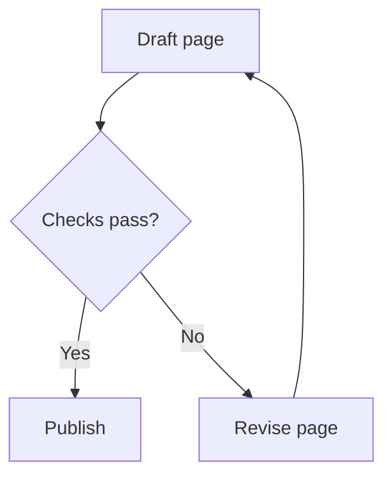
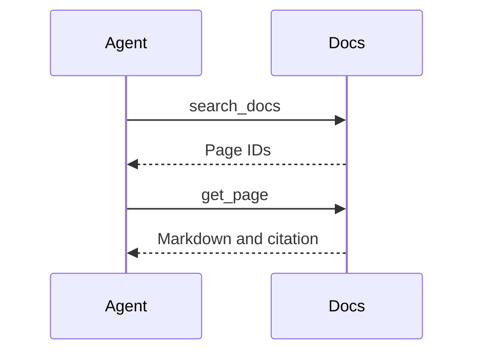
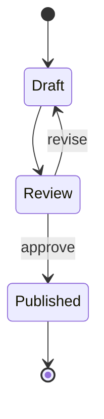
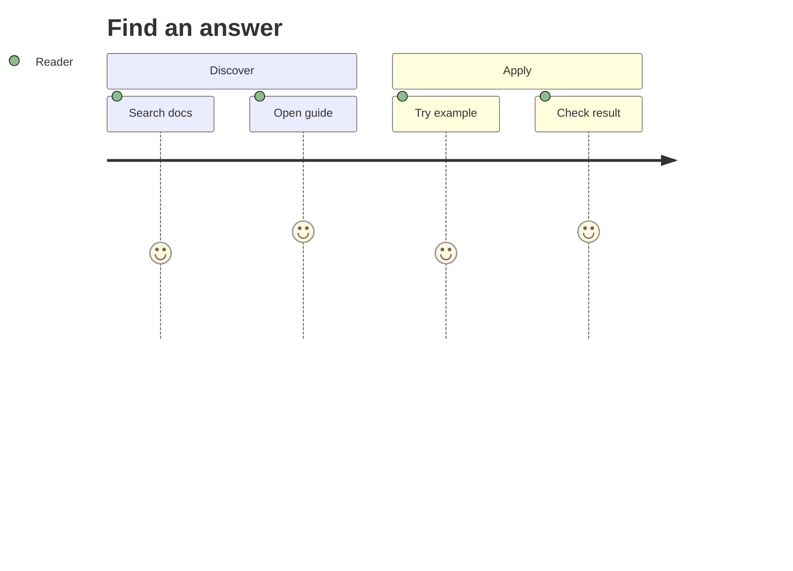
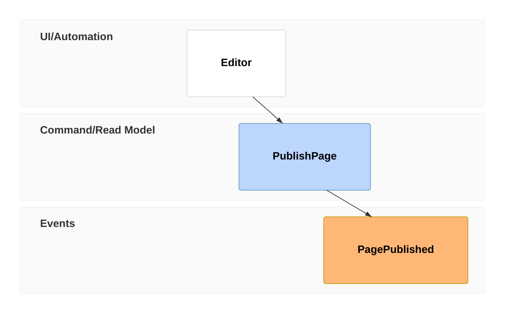
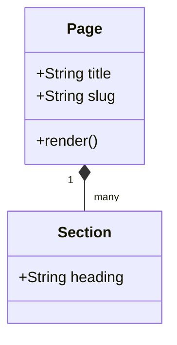
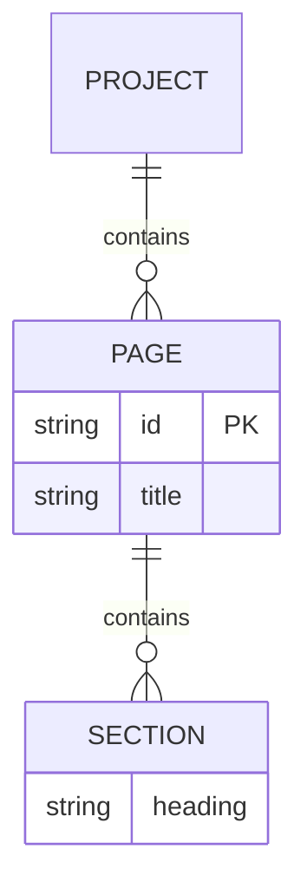

# Pele gallery

> Documentation index: [llms.min.txt](https://www.shoalrun.com/llms.min.txt) · Document manifest: [documents.json](https://www.shoalrun.com/documents.json)

Navigation section: [Docs](https://www.shoalrun.com/.well-known/shoalrun/navigation/docs-50f26fe22670.txt) (ID: docs). [All sections and pages](https://www.shoalrun.com/llms.min.txt)

Breadcrumbs: [Docs](https://www.shoalrun.com/what-is-shoalrun.md) > Write documentation > Components > Diagrams > Pele gallery

**Updated: 2026-10-17.**

Browse examples of Pele's 33 built-in diagram families, including its version display, and 48 flowchart shapes. Every example uses Shoalrun's [Diagram component](https://www.shoalrun.com/author/components/diagrams.md) with Mermaid syntax. These illustrate notation; they do not describe live services or measured product results.

Open **Source** beneath a diagram to copy its syntax. See [Pele's examples](https://pele.run/examples) for more variations and [compatibility notes](https://pele.run/compatibility) for differences from Mermaid.

## Flows and behavior

### Flowchart

Follow decisions and retry paths.

**Flowchart**

Follow decisions and retry paths.

[View Flowchart diagram](https://www.shoalrun.com/assets/diagrams/mermaid-01bf063c511f0148eaf3-light.svg)



### Source: Flowchart


### Sequence

Trace messages between an agent and documentation tools.

**Sequence**

Trace messages between an agent and documentation tools.

[View Sequence diagram](https://www.shoalrun.com/assets/diagrams/mermaid-c8435890ac77644550f4-light.svg)



### Source: Sequence


### State

Explain a document lifecycle.

**State**

Explain a document lifecycle.

[View State diagram](https://www.shoalrun.com/assets/diagrams/mermaid-4bf34eecf23a18a481f4-light.svg)



### Source: State


### Agentflow

Show agent tasks and decisions.

**Agentflow**

Show agent tasks and decisions.

[View Agentflow diagram](https://www.shoalrun.com/assets/diagrams/mermaid-10f5be0bd12d01559e8a-light.svg)

```mermaid
agentflow-beta TB
 draft["Draft guide"]@{ shape: task }
 check["Checks pass?"]@{ shape: decision }
 publish["Publish guide"]@{ shape: action }
 draft --> check
 check -- yes --> publish
 check -- no --> draft
```

### Source: Agentflow

```mermaid
agentflow-beta TB
 draft["Draft guide"]@{ shape: task }
 check["Checks pass?"]@{ shape: decision }
 publish["Publish guide"]@{ shape: action }
 draft --> check
 check -- yes --> publish
 check -- no --> draft
```

### Swimlane

Separate work by team.

**Swimlane**

Separate work by team.

[View Swimlane diagram](https://www.shoalrun.com/assets/diagrams/mermaid-1c54ec86ada1acf56cad-light.svg)

```mermaid
swimlane-beta LR
 subgraph Authors
  draft[Draft guide]
 end
 subgraph Reviewers
  review[Review guide]
 end
 draft --> review
```

### Source: Swimlane

```mermaid
swimlane-beta LR
 subgraph Authors
  draft[Draft guide]
 end
 subgraph Reviewers
  review[Review guide]
 end
 draft --> review
```

### User journey

Show the stages and participants in a reader journey.

**User journey**

Show the stages and participants in a reader journey.

[View User journey diagram](https://www.shoalrun.com/assets/diagrams/mermaid-c00b03674141fa1e9fa1-light.svg)



### Source: User journey


### Event modeling

Trace interface actions and resulting events.

**Event modeling**

Trace interface actions and resulting events.

[View Event modeling diagram](https://www.shoalrun.com/assets/diagrams/mermaid-7e5670e2a62a648b2f63-light.svg)



### Source: Event modeling


### Use case

Connect an actor to a supported action.

**Use case**

Connect an actor to a supported action.

[View Use case diagram](https://www.shoalrun.com/assets/diagrams/mermaid-e9ae1890e68f4da28948-light.svg)

```mermaid
usecase-beta
 actor Reader
 Browse[Browse documentation]
 Search[Search documentation]
 Reader --> Browse
 Reader --> Search
```

### Source: Use case

```mermaid
usecase-beta
 actor Reader
 Browse[Browse documentation]
 Search[Search documentation]
 Reader --> Browse
 Reader --> Search
```

## Systems and structures

### Class

Describe types, fields, and relationships.

**Class**

Describe types, fields, and relationships.

[View Class diagram](https://www.shoalrun.com/assets/diagrams/mermaid-af73adf46c1d18e97da9-light.svg)



### Source: Class


### Entity relationship

Show entities and relationship cardinality.

**Entity relationship**

Show entities and relationship cardinality.

[View Entity relationship diagram](https://www.shoalrun.com/assets/diagrams/mermaid-2c935f03a00d8732c5f6-light.svg)



### Source: Entity relationship


### Architecture

Connect services using built-in symbols.

**Architecture**

Connect services using built-in symbols.

[View Architecture diagram](https://www.shoalrun.com/assets/diagrams/mermaid-2604ab6aac56722b033b-light.svg)

```mermaid
architecture-beta
 group docs(cloud)[Documentation]
 service app(server)[Site] in docs
 service store(database)[Content] in docs
 app:R -- L:store
```

### Source: Architecture

```mermaid
architecture-beta
 group docs(cloud)[Documentation]
 service app(server)[Site] in docs
 service store(database)[Content] in docs
 app:R -- L:store
```

### C4

Describe a system and its users at a high level.

**C4**

Describe a system and its users at a high level.

[View C4 diagram](https://www.shoalrun.com/assets/diagrams/mermaid-d31ce80c287440a978dd-light.svg)

```mermaid
C4Context
 title Documentation context
 Person(reader, "Reader", "Finds instructions")
 System(docs, "Documentation", "Published guides")
 Rel(reader, docs, "Reads")
```

### Source: C4

```mermaid
C4Context
 title Documentation context
 Person(reader, "Reader", "Finds instructions")
 System(docs, "Documentation", "Published guides")
 Rel(reader, docs, "Reads")
```

### Block

Arrange connected blocks in explicit columns.

**Block**

Arrange connected blocks in explicit columns.

[View Block diagram](https://www.shoalrun.com/assets/diagrams/mermaid-4b2a2cf39d3fe9446598-light.svg)

```mermaid
block-beta
 columns 3
 a["Author"] b["Build"] c["Publish"]
 a --> b
 b --> c
```

### Source: Block

```mermaid
block-beta
 columns 3
 a["Author"] b["Build"] c["Publish"]
 a --> b
 b --> c
```

### Mindmap

Organize related documentation topics.

**Mindmap**

Organize related documentation topics.

[View Mindmap diagram](https://www.shoalrun.com/assets/diagrams/mermaid-5132acfd3a5b749b60f6-light.svg)

```mermaid
mindmap
 root((Documentation))
  Authoring
   Pages
   Components
  Publishing
   Builds
   Hosting
```

### Source: Mindmap

```mermaid
mindmap
 root((Documentation))
  Authoring
   Pages
   Components
  Publishing
   Builds
   Hosting
```

### Tree view

Display a directory hierarchy.

**Tree view**

Display a directory hierarchy.

[View Tree view diagram](https://www.shoalrun.com/assets/diagrams/mermaid-b87a0cb8033d4ea6c61b-light.svg)

```mermaid
treeView-beta
 "docs"
  "content"
   "start.mdx"
   "configuration.mdx"
  "docs.config.yaml"
```

### Source: Tree view

```mermaid
treeView-beta
 "docs"
  "content"
   "start.mdx"
   "configuration.mdx"
  "docs.config.yaml"
```

### Requirement

Connect an implementation element to a requirement.

**Requirement**

Connect an implementation element to a requirement.

[View Requirement diagram](https://www.shoalrun.com/assets/diagrams/mermaid-9b74d503a97fb3b146ea-light.svg)

```mermaid
requirementDiagram
 requirement readable {
 id: 1
 text: Preserve essential instructions
 risk: low
 verifymethod: test
 }
 element markdown {
 type: renderer
 }
 markdown - satisfies -> readable
```

### Source: Requirement

```mermaid
requirementDiagram
 requirement readable {
 id: 1
 text: Preserve essential instructions
 risk: low
 verifymethod: test
 }
 element markdown {
 type: renderer
 }
 markdown - satisfies -> readable
```

## Charts and planning

### Gantt

Schedule work against explicit dates.

**Gantt**

Schedule work against explicit dates.

[View Gantt diagram](https://www.shoalrun.com/assets/diagrams/mermaid-bc14dd13a7120c96ca7d-light.svg)

```mermaid
gantt
 title Documentation release
 dateFormat YYYY-MM-DD
 section Preparation
 Draft guides :a, 2026-10-01, 3d
 Review guides :b, after a, 2d
 section Release
 Publish :after b, 1d
```

### Source: Gantt

```mermaid
gantt
 title Documentation release
 dateFormat YYYY-MM-DD
 section Preparation
 Draft guides :a, 2026-10-01, 3d
 Review guides :b, after a, 2d
 section Release
 Publish :after b, 1d
```

### Git graph

Illustrate branches, commits, and merges.

**Git graph**

Illustrate branches, commits, and merges.

[View Git graph diagram](https://www.shoalrun.com/assets/diagrams/mermaid-e5ae178043ea21b49cdb-light.svg)

```mermaid
gitGraph
 commit id: "Start"
 branch guide
 checkout guide
 commit id: "Draft"
 checkout main
 merge guide
 commit id: "Publish"
```

### Source: Git graph

```mermaid
gitGraph
 commit id: "Start"
 branch guide
 checkout guide
 commit id: "Draft"
 checkout main
 merge guide
 commit id: "Publish"
```

### Pie

Compare proportions with explicit values.

**Pie**

Compare proportions with explicit values.

[View Pie diagram](https://www.shoalrun.com/assets/diagrams/mermaid-18a3bc3966a71d8e5701-light.svg)

```mermaid
pie title Example traffic channels
 "Direct" : 45
 "Search" : 35
 "Referral" : 20
```

### Source: Pie

```mermaid
pie title Example traffic channels
 "Direct" : 45
 "Search" : 35
 "Referral" : 20
```

### Kanban

Group tasks by workflow stage.

**Kanban**

Group tasks by workflow stage.

[View Kanban diagram](https://www.shoalrun.com/assets/diagrams/mermaid-93942a7f879aa38866d2-light.svg)

```mermaid
kanban
 todo[To do]
  setup[Configure project]
 review[Review]
  draft[Review guide]
 done[Done]
  install[Install tools]
```

### Source: Kanban

```mermaid
kanban
 todo[To do]
  setup[Configure project]
 review[Review]
  draft[Review guide]
 done[Done]
  install[Install tools]
```

### Timeline

Place milestones in chronological order.

**Timeline**

Place milestones in chronological order.

[View Timeline diagram](https://www.shoalrun.com/assets/diagrams/mermaid-4c5caba21e87b8315eb0-light.svg)

```mermaid
timeline
 title Documentation rollout
 Week 1 : Draft guides
 Week 2 : Review examples : Test installation
 Week 3 : Publish documentation
```

### Source: Timeline

```mermaid
timeline
 title Documentation rollout
 Week 1 : Draft guides
 Week 2 : Review examples : Test installation
 Week 3 : Publish documentation
```

### Quadrant chart

Compare work along two dimensions.

**Quadrant chart**

Compare work along two dimensions.

[View Quadrant chart diagram](https://www.shoalrun.com/assets/diagrams/mermaid-4f3126e587f0668928db-light.svg)

```mermaid
quadrantChart
 title Example priorities
 x-axis Low effort --> High effort
 y-axis Low impact --> High impact
 quadrant-1 Plan
 quadrant-2 Start
 quadrant-3 Defer
 quadrant-4 Reconsider
 Navigation: [0.25, 0.8]
 Rewrite: [0.8, 0.65]
 Cleanup: [0.2, 0.2]
```

### Source: Quadrant chart

```mermaid
quadrantChart
 title Example priorities
 x-axis Low effort --> High effort
 y-axis Low impact --> High impact
 quadrant-1 Plan
 quadrant-2 Start
 quadrant-3 Defer
 quadrant-4 Reconsider
 Navigation: [0.25, 0.8]
 Rewrite: [0.8, 0.65]
 Cleanup: [0.2, 0.2]
```

### XY chart

Compare values on labeled axes.

**XY chart**

Compare values on labeled axes.

[View XY chart diagram](https://www.shoalrun.com/assets/diagrams/mermaid-0df2ca68065a8841e446-light.svg)

```mermaid
xychart-beta
 title "Example weekly builds"
 x-axis [W1, W2, W3, W4]
 y-axis "Builds" 0 --> 50
 bar [12, 24, 32, 41]
 line [10, 20, 28, 35]
```

### Source: XY chart

```mermaid
xychart-beta
 title "Example weekly builds"
 x-axis [W1, W2, W3, W4]
 y-axis "Builds" 0 --> 50
 bar [12, 24, 32, 41]
 line [10, 20, 28, 35]
```

### Sankey

Show how quantities flow between groups.

**Sankey**

Show how quantities flow between groups.

[View Sankey diagram](https://www.shoalrun.com/assets/diagrams/mermaid-727b8fe84d5cec7c97a6-light.svg)

```mermaid
sankey-beta
 Sources,Guides,30
 Sources,Reference,20
 Guides,Readers,25
 Guides,Agents,5
 Reference,Readers,10
 Reference,Agents,10
```

### Source: Sankey

```mermaid
sankey-beta
 Sources,Guides,30
 Sources,Reference,20
 Guides,Readers,25
 Guides,Agents,5
 Reference,Readers,10
 Reference,Agents,10
```

### Radar

Compare several dimensions for two example approaches.

**Radar**

Compare several dimensions for two example approaches.

[View Radar diagram](https://www.shoalrun.com/assets/diagrams/mermaid-e6c71672433e8c18e22c-light.svg)

```mermaid
radar-beta
 title Example review scores
 axis a["Clarity"], b["Coverage"], c["Speed"]
 curve x["Approach A"]{4, 3, 5}
 curve y["Approach B"]{3, 5, 3}
 max 5
```

### Source: Radar

```mermaid
radar-beta
 title Example review scores
 axis a["Clarity"], b["Coverage"], c["Speed"]
 curve x["Approach A"]{4, 3, 5}
 curve y["Approach B"]{3, 5, 3}
 max 5
```

### Treemap

Compare the size of nested categories.

**Treemap**

Compare the size of nested categories.

[View Treemap diagram](https://www.shoalrun.com/assets/diagrams/mermaid-a600d77e82d5e5b73128-light.svg)

```mermaid
treemap-beta
 "Documentation"
  "Guides": 30
  "Reference": 45
  "Tutorials": 25
```

### Source: Treemap

```mermaid
treemap-beta
 "Documentation"
  "Guides": 30
  "Reference": 45
  "Tutorials": 25
```

## Specialized diagrams

### Cynefin

Group decisions by their operating context.

**Cynefin**

Group decisions by their operating context.

[View Cynefin diagram](https://www.shoalrun.com/assets/diagrams/mermaid-3ac08e0ce15b0be58045-light.svg)

```mermaid
cynefin-beta
 title Documentation decisions
 complex
  "Test new navigation"
 complicated
  "Review API coverage"
 clear
  "Fix broken link"
 chaotic
  "Restore unavailable site"
```

### Source: Cynefin

```mermaid
cynefin-beta
 title Documentation decisions
 complex
  "Test new navigation"
 complicated
  "Review API coverage"
 clear
  "Fix broken link"
 chaotic
  "Restore unavailable site"
```

### Wardley map

Relate a reader need to supporting capabilities.

**Wardley map**

Relate a reader need to supporting capabilities.

[View Wardley map diagram](https://www.shoalrun.com/assets/diagrams/mermaid-6c727aa91f970174ef39-light.svg)

```mermaid
wardley-beta
 title Documentation capabilities
 anchor Reader [0.95, 0.80]
 component Guides [0.70, 0.55]
 component Hosting [0.30, 0.90]
 Reader -> Guides
 Guides -> Hosting
```

### Source: Wardley map

```mermaid
wardley-beta
 title Documentation capabilities
 anchor Reader [0.95, 0.80]
 component Guides [0.70, 0.55]
 component Hosting [0.30, 0.90]
 Reader -> Guides
 Guides -> Hosting
```

### Ishikawa

Organize possible causes of a problem.

**Ishikawa**

Organize possible causes of a problem.

[View Ishikawa diagram](https://www.shoalrun.com/assets/diagrams/mermaid-b76432c5a764f64d4b7e-light.svg)

```mermaid
ishikawa-beta
 Slow documentation build
 Content
  Large diagrams
  Duplicate inputs
 Environment
  Cold cache
  Missing dependencies
```

### Source: Ishikawa

```mermaid
ishikawa-beta
 Slow documentation build
 Content
  Large diagrams
  Duplicate inputs
 Environment
  Cold cache
  Missing dependencies
```

### Packet

Describe a small binary record layout.

**Packet**

Describe a small binary record layout.

[View Packet diagram](https://www.shoalrun.com/assets/diagrams/mermaid-05b44617b4597865c1b5-light.svg)

```mermaid
packet-beta
 title Example record header
 0-7: "Version"
 8-15: "Flags"
 16-31: "Length"
```

### Source: Packet

```mermaid
packet-beta
 title Example record header
 0-7: "Version"
 8-15: "Flags"
 16-31: "Length"
```

### Railroad

Describe a small grammar using EBNF.

**Railroad**

Describe a small grammar using EBNF.

[View Railroad diagram](https://www.shoalrun.com/assets/diagrams/mermaid-a1113e4926b9ac3fce4f-light.svg)

```mermaid
railroad-ebnf-beta
 name = "guide" | "reference" ;
 command = "read", name ;
```

### Source: Railroad

```mermaid
railroad-ebnf-beta
 name = "guide" | "reference" ;
 command = "read", name ;
```

### Venn

Show overlapping sets of requirements.

**Venn**

Show overlapping sets of requirements.

[View Venn diagram](https://www.shoalrun.com/assets/diagrams/mermaid-dfe4d120d6bd5a8af4c1-light.svg)

```mermaid
venn-beta
 set A["Readable"]
 set B["Searchable"]
 union A,B["Useful docs"]
```

### Source: Venn

```mermaid
venn-beta
 set A["Readable"]
 set B["Searchable"]
 union A,B["Useful docs"]
```

### Renderer information

Display the renderer version as an informational diagram.

**Renderer information**

Display the renderer version as an informational diagram.

[View Renderer information diagram](https://www.shoalrun.com/assets/diagrams/mermaid-26d147f9c6a7ee30fbd4-light.svg)

```mermaid
info
```

### Source: Renderer information

```mermaid
info
```

## Flowchart shapes

These sheets show the shape names accepted by Mermaid’s extended node syntax. Each sheet connects eight shapes in two columns.

### Flowchart shapes 1

Compare rect, rounded, stadium, fr-rect, cyl, circle, dbl-circ, diam.

**Flowchart shapes 1**

Compare rect, rounded, stadium, fr-rect, cyl, circle, dbl-circ, diam.

[View Flowchart shapes 1 diagram](https://www.shoalrun.com/assets/diagrams/mermaid-0d9861176e52b1671c3f-light.svg)

```mermaid
flowchart TB
 n0@{ shape: rect, label: "rect" }
 n1@{ shape: rounded, label: "rounded" }
 n2@{ shape: stadium, label: "stadium" }
 n3@{ shape: fr-rect, label: "fr-rect" }
 n4@{ shape: cyl, label: "cyl" }
 n5@{ shape: circle, label: "circle" }
 n6@{ shape: dbl-circ, label: "dbl-circ" }
 n7@{ shape: diam, label: "diam" }
 n0 --> n1 --> n2 --> n3
 n4 --> n5 --> n6 --> n7
```

### Source: Flowchart shapes 1

```mermaid
flowchart TB
 n0@{ shape: rect, label: "rect" }
 n1@{ shape: rounded, label: "rounded" }
 n2@{ shape: stadium, label: "stadium" }
 n3@{ shape: fr-rect, label: "fr-rect" }
 n4@{ shape: cyl, label: "cyl" }
 n5@{ shape: circle, label: "circle" }
 n6@{ shape: dbl-circ, label: "dbl-circ" }
 n7@{ shape: diam, label: "diam" }
 n0 --> n1 --> n2 --> n3
 n4 --> n5 --> n6 --> n7
```

### Flowchart shapes 2

Compare hex, odd, lean-r, lean-l, trap-b, trap-t, text, bow-rect.

**Flowchart shapes 2**

Compare hex, odd, lean-r, lean-l, trap-b, trap-t, text, bow-rect.

[View Flowchart shapes 2 diagram](https://www.shoalrun.com/assets/diagrams/mermaid-f730aac749f3c67db89c-light.svg)

```mermaid
flowchart TB
 n0@{ shape: hex, label: "hex" }
 n1@{ shape: odd, label: "odd" }
 n2@{ shape: lean-r, label: "lean-r" }
 n3@{ shape: lean-l, label: "lean-l" }
 n4@{ shape: trap-b, label: "trap-b" }
 n5@{ shape: trap-t, label: "trap-t" }
 n6@{ shape: text, label: "text" }
 n7@{ shape: bow-rect, label: "bow-rect" }
 n0 --> n1 --> n2 --> n3
 n4 --> n5 --> n6 --> n7
```

### Source: Flowchart shapes 2

```mermaid
flowchart TB
 n0@{ shape: hex, label: "hex" }
 n1@{ shape: odd, label: "odd" }
 n2@{ shape: lean-r, label: "lean-r" }
 n3@{ shape: lean-l, label: "lean-l" }
 n4@{ shape: trap-b, label: "trap-b" }
 n5@{ shape: trap-t, label: "trap-t" }
 n6@{ shape: text, label: "text" }
 n7@{ shape: bow-rect, label: "bow-rect" }
 n0 --> n1 --> n2 --> n3
 n4 --> n5 --> n6 --> n7
```

### Flowchart shapes 3

Compare sm-circ, f-circ, fr-circ, fork, notch-rect, lin-rect, div-rect, win-pane.

**Flowchart shapes 3**

Compare sm-circ, f-circ, fr-circ, fork, notch-rect, lin-rect, div-rect, win-pane.

[View Flowchart shapes 3 diagram](https://www.shoalrun.com/assets/diagrams/mermaid-df98ced61cd6e22a57d4-light.svg)

```mermaid
flowchart TB
 n0@{ shape: sm-circ, label: "sm-circ" }
 n1@{ shape: f-circ, label: "f-circ" }
 n2@{ shape: fr-circ, label: "fr-circ" }
 n3@{ shape: fork, label: "fork" }
 n4@{ shape: notch-rect, label: "notch-rect" }
 n5@{ shape: lin-rect, label: "lin-rect" }
 n6@{ shape: div-rect, label: "div-rect" }
 n7@{ shape: win-pane, label: "win-pane" }
 n0 --> n1 --> n2 --> n3
 n4 --> n5 --> n6 --> n7
```

### Source: Flowchart shapes 3

```mermaid
flowchart TB
 n0@{ shape: sm-circ, label: "sm-circ" }
 n1@{ shape: f-circ, label: "f-circ" }
 n2@{ shape: fr-circ, label: "fr-circ" }
 n3@{ shape: fork, label: "fork" }
 n4@{ shape: notch-rect, label: "notch-rect" }
 n5@{ shape: lin-rect, label: "lin-rect" }
 n6@{ shape: div-rect, label: "div-rect" }
 n7@{ shape: win-pane, label: "win-pane" }
 n0 --> n1 --> n2 --> n3
 n4 --> n5 --> n6 --> n7
```

### Flowchart shapes 4

Compare notch-pent, cross-circ, st-rect, datastore, lin-cyl, tag-rect, doc, tri.

**Flowchart shapes 4**

Compare notch-pent, cross-circ, st-rect, datastore, lin-cyl, tag-rect, doc, tri.

[View Flowchart shapes 4 diagram](https://www.shoalrun.com/assets/diagrams/mermaid-24bd98b3f8a615e56e35-light.svg)

```mermaid
flowchart TB
 n0@{ shape: notch-pent, label: "notch-pent" }
 n1@{ shape: cross-circ, label: "cross-circ" }
 n2@{ shape: st-rect, label: "st-rect" }
 n3@{ shape: datastore, label: "datastore" }
 n4@{ shape: lin-cyl, label: "lin-cyl" }
 n5@{ shape: tag-rect, label: "tag-rect" }
 n6@{ shape: doc, label: "doc" }
 n7@{ shape: tri, label: "tri" }
 n0 --> n1 --> n2 --> n3
 n4 --> n5 --> n6 --> n7
```

### Source: Flowchart shapes 4

```mermaid
flowchart TB
 n0@{ shape: notch-pent, label: "notch-pent" }
 n1@{ shape: cross-circ, label: "cross-circ" }
 n2@{ shape: st-rect, label: "st-rect" }
 n3@{ shape: datastore, label: "datastore" }
 n4@{ shape: lin-cyl, label: "lin-cyl" }
 n5@{ shape: tag-rect, label: "tag-rect" }
 n6@{ shape: doc, label: "doc" }
 n7@{ shape: tri, label: "tri" }
 n0 --> n1 --> n2 --> n3
 n4 --> n5 --> n6 --> n7
```

### Flowchart shapes 5

Compare flip-tri, sl-rect, hourglass, delay, h-cyl, curv-trap, docs, flag.

**Flowchart shapes 5**

Compare flip-tri, sl-rect, hourglass, delay, h-cyl, curv-trap, docs, flag.

[View Flowchart shapes 5 diagram](https://www.shoalrun.com/assets/diagrams/mermaid-90ad759794fd78e2827e-light.svg)

```mermaid
flowchart TB
 n0@{ shape: flip-tri, label: "flip-tri" }
 n1@{ shape: sl-rect, label: "sl-rect" }
 n2@{ shape: hourglass, label: "hourglass" }
 n3@{ shape: delay, label: "delay" }
 n4@{ shape: h-cyl, label: "h-cyl" }
 n5@{ shape: curv-trap, label: "curv-trap" }
 n6@{ shape: docs, label: "docs" }
 n7@{ shape: flag, label: "flag" }
 n0 --> n1 --> n2 --> n3
 n4 --> n5 --> n6 --> n7
```

### Source: Flowchart shapes 5

```mermaid
flowchart TB
 n0@{ shape: flip-tri, label: "flip-tri" }
 n1@{ shape: sl-rect, label: "sl-rect" }
 n2@{ shape: hourglass, label: "hourglass" }
 n3@{ shape: delay, label: "delay" }
 n4@{ shape: h-cyl, label: "h-cyl" }
 n5@{ shape: curv-trap, label: "curv-trap" }
 n6@{ shape: docs, label: "docs" }
 n7@{ shape: flag, label: "flag" }
 n0 --> n1 --> n2 --> n3
 n4 --> n5 --> n6 --> n7
```

### Flowchart shapes 6

Compare bolt, bang, cloud, brace, brace-r, braces, tag-doc, lin-doc.

**Flowchart shapes 6**

Compare bolt, bang, cloud, brace, brace-r, braces, tag-doc, lin-doc.

[View Flowchart shapes 6 diagram](https://www.shoalrun.com/assets/diagrams/mermaid-3ccccdf2e0fb678a7fc0-light.svg)

```mermaid
flowchart TB
 n0@{ shape: bolt, label: "bolt" }
 n1@{ shape: bang, label: "bang" }
 n2@{ shape: cloud, label: "cloud" }
 n3@{ shape: brace, label: "brace" }
 n4@{ shape: brace-r, label: "brace-r" }
 n5@{ shape: braces, label: "braces" }
 n6@{ shape: tag-doc, label: "tag-doc" }
 n7@{ shape: lin-doc, label: "lin-doc" }
 n0 --> n1 --> n2 --> n3
 n4 --> n5 --> n6 --> n7
```

### Source: Flowchart shapes 6

```mermaid
flowchart TB
 n0@{ shape: bolt, label: "bolt" }
 n1@{ shape: bang, label: "bang" }
 n2@{ shape: cloud, label: "cloud" }
 n3@{ shape: brace, label: "brace" }
 n4@{ shape: brace-r, label: "brace-r" }
 n5@{ shape: braces, label: "braces" }
 n6@{ shape: tag-doc, label: "tag-doc" }
 n7@{ shape: lin-doc, label: "lin-doc" }
 n0 --> n1 --> n2 --> n3
 n4 --> n5 --> n6 --> n7
```

## HTML, Markdown, and agents

The diagrams are generated during the build and work without JavaScript. Theme changes update their CSS colors. Markdown retains every title, summary, SVG link, and original source, including examples inside closed disclosures.

This gallery checks one example per diagram family and the listed flowchart shapes. It does not establish support for every syntax variation or external Mermaid plugin. Shoalrun disables diagram links, external images, and JavaScript callbacks. See [styling and compatibility](https://www.shoalrun.com/author/components/diagrams.md) before migrating existing diagrams.

## Related reading

### Reference while working

- [Diagrams](https://www.shoalrun.com/author/components/diagrams.md) — Configure diagram width, styling, and Mermaid compatibility.

### Related topics

- [D2 gallery](https://www.shoalrun.com/author/components/diagrams/d2-gallery.md) — Compare D2 examples with Mermaid syntax rendered by Pele.
