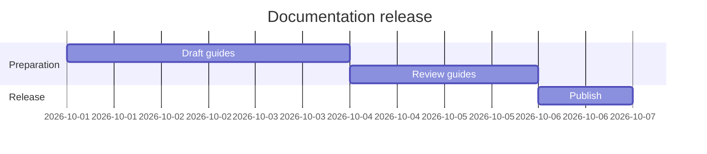
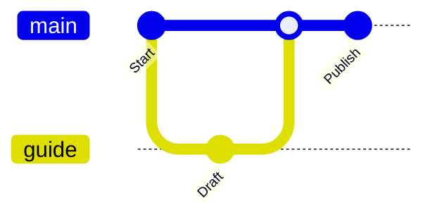
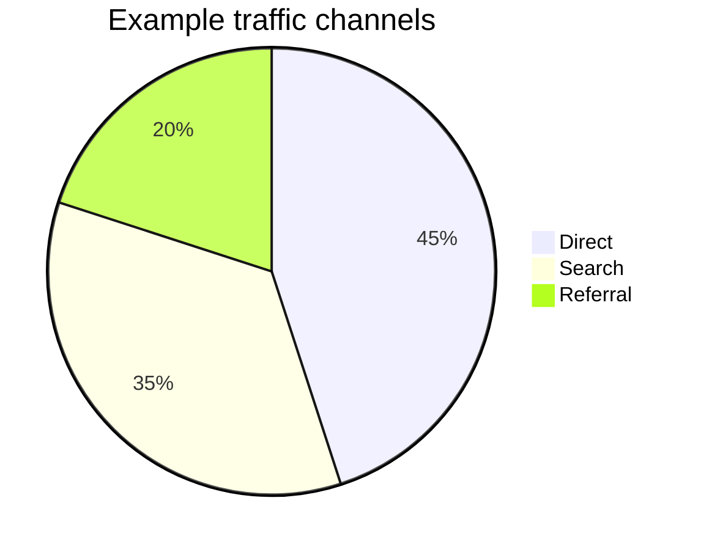
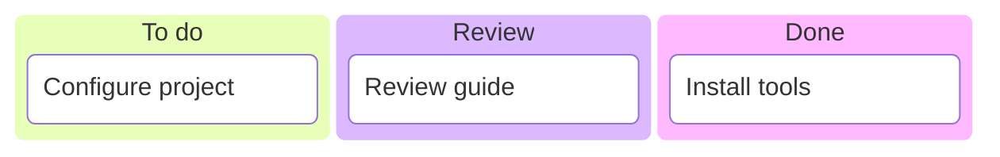
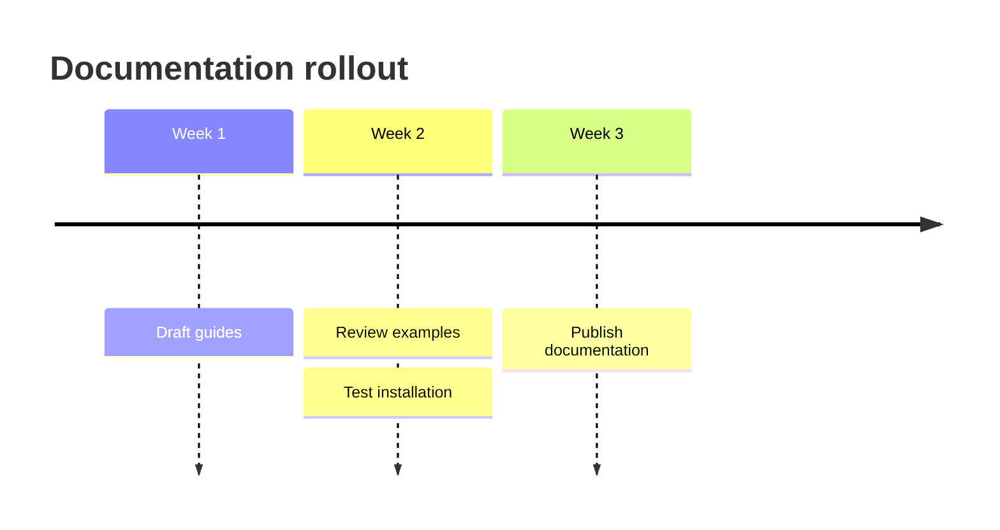
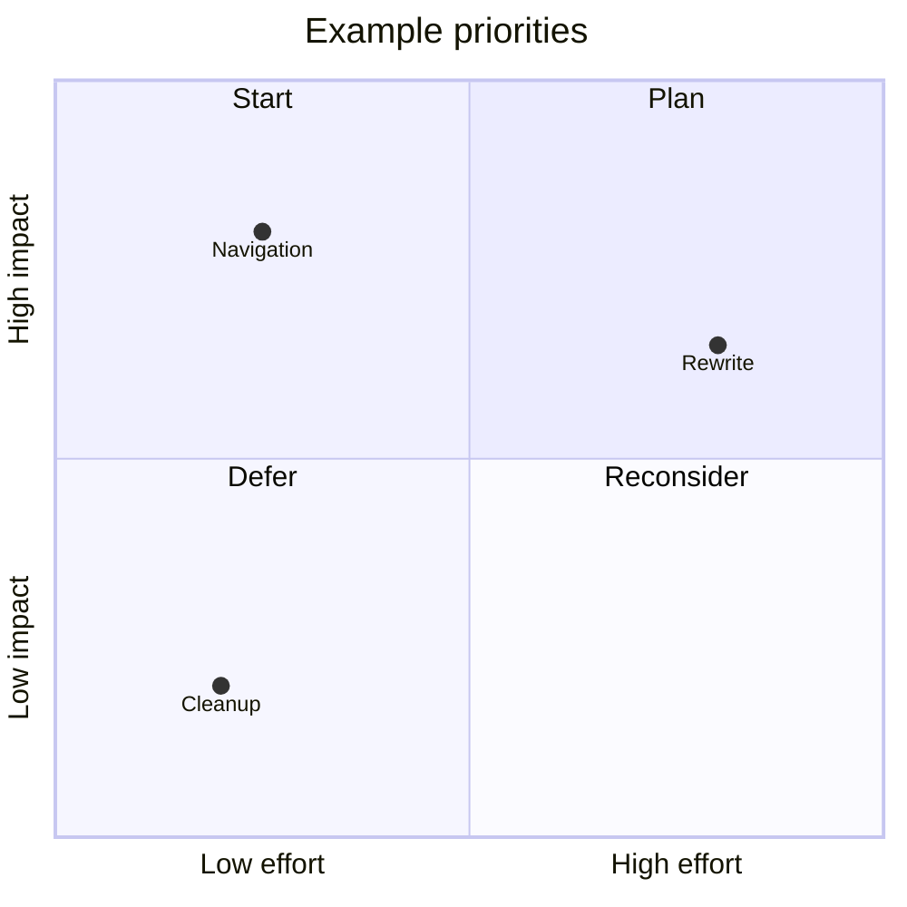
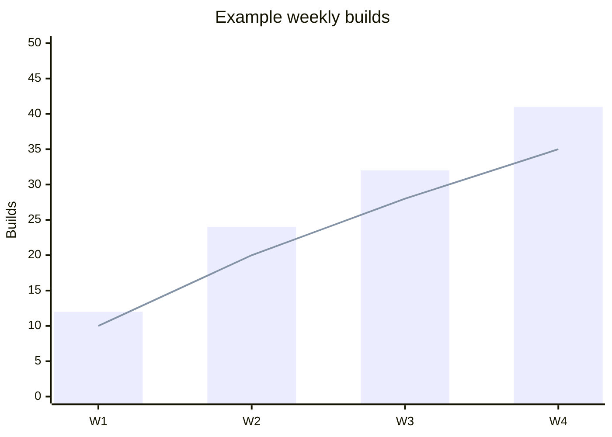
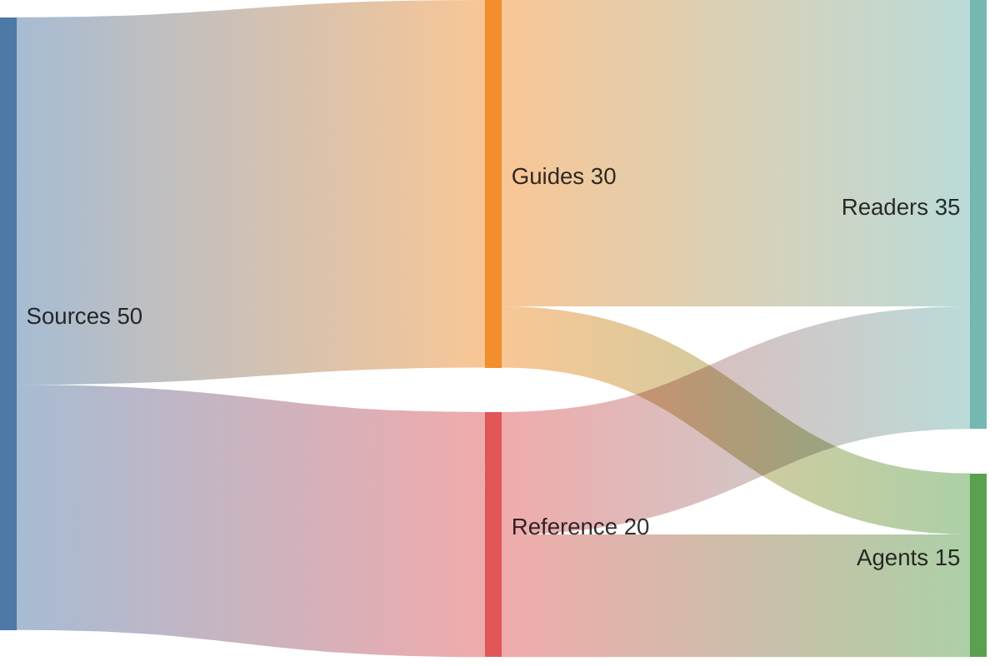
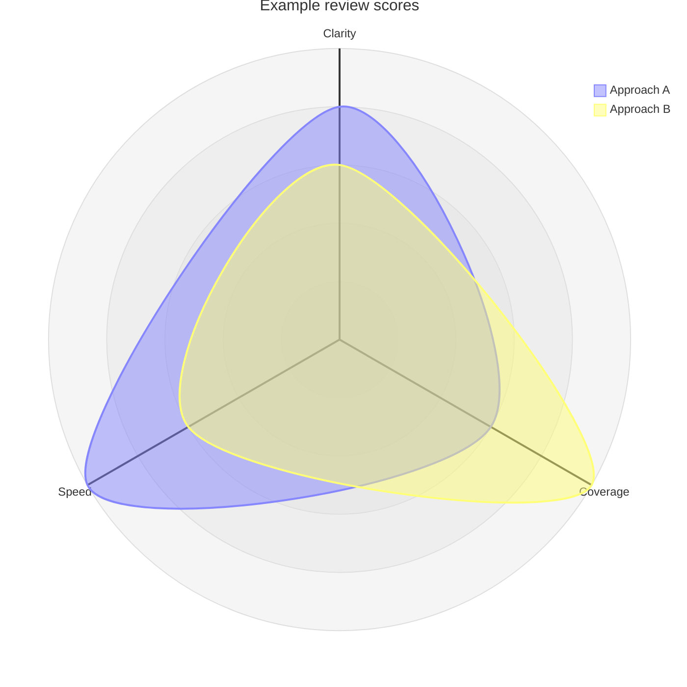
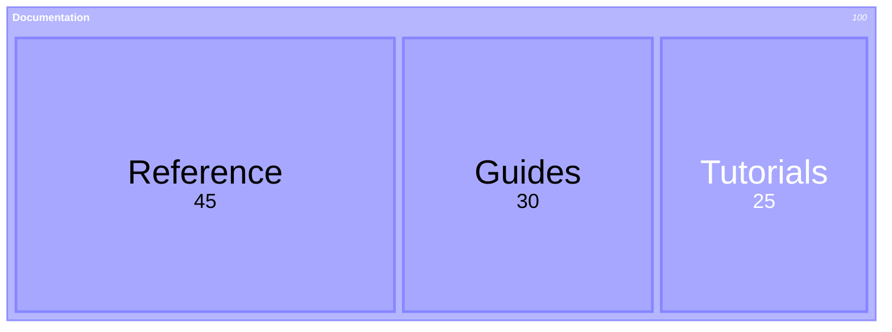

# Pele gallery

> Documentation index: [llms.min.txt](https://www.shoalrun.com/llms.min.txt) · Document manifest: [documents.json](https://www.shoalrun.com/documents.json)

Navigation section: [Docs](https://www.shoalrun.com/.well-known/shoalrun/navigation/docs-50f26fe22670.txt) (ID: docs). [All sections and pages](https://www.shoalrun.com/llms.min.txt)

Breadcrumbs: [Docs](https://www.shoalrun.com/what-is-shoalrun.md) > Write documentation > Components > Diagrams > Pele gallery

**Updated: 2026-10-26.**

Parent page: [Full Markdown page](/author/components/diagrams/pele-gallery.md)

Browse examples of Pele's 33 built-in diagram families, including its version display, and 48 flowchart shapes. Every example uses Shoalrun's [Diagram component](https://www.shoalrun.com/author/components/diagrams.md) with Mermaid syntax. These illustrate notation; they do not describe live services or measured product results.

Open **Source** beneath a diagram to copy its syntax. See [Pele's examples](https://pele.run/examples) for more variations and [compatibility notes](https://pele.run/compatibility) for differences from Mermaid.

## Charts and planning

### Gantt

Schedule work against explicit dates.

**Gantt**

Schedule work against explicit dates.

[View Gantt diagram](https://www.shoalrun.com/assets/diagrams/mermaid-bc14dd13a7120c96ca7d-light.svg)

### Source: Gantt

### Git graph

Illustrate branches, commits, and merges.

**Git graph**

Illustrate branches, commits, and merges.

[View Git graph diagram](https://www.shoalrun.com/assets/diagrams/mermaid-e5ae178043ea21b49cdb-light.svg)

### Source: Git graph

### Pie

Compare proportions with explicit values.

**Pie**

Compare proportions with explicit values.

[View Pie diagram](https://www.shoalrun.com/assets/diagrams/mermaid-18a3bc3966a71d8e5701-light.svg)

### Source: Pie

### Kanban

Group tasks by workflow stage.

**Kanban**

Group tasks by workflow stage.

[View Kanban diagram](https://www.shoalrun.com/assets/diagrams/mermaid-93942a7f879aa38866d2-light.svg)

### Source: Kanban

### Timeline

Place milestones in chronological order.

**Timeline**

Place milestones in chronological order.

[View Timeline diagram](https://www.shoalrun.com/assets/diagrams/mermaid-4c5caba21e87b8315eb0-light.svg)

### Source: Timeline

### Quadrant chart

Compare work along two dimensions.

**Quadrant chart**

Compare work along two dimensions.

[View Quadrant chart diagram](https://www.shoalrun.com/assets/diagrams/mermaid-4f3126e587f0668928db-light.svg)

### Source: Quadrant chart

### XY chart

Compare values on labeled axes.

**XY chart**

Compare values on labeled axes.

[View XY chart diagram](https://www.shoalrun.com/assets/diagrams/mermaid-0df2ca68065a8841e446-light.svg)

### Source: XY chart

### Sankey

Show how quantities flow between groups.

**Sankey**

Show how quantities flow between groups.

[View Sankey diagram](https://www.shoalrun.com/assets/diagrams/mermaid-727b8fe84d5cec7c97a6-light.svg)

### Source: Sankey

### Radar

Compare several dimensions for two example approaches.

**Radar**

Compare several dimensions for two example approaches.

[View Radar diagram](https://www.shoalrun.com/assets/diagrams/mermaid-e6c71672433e8c18e22c-light.svg)

### Source: Radar

### Treemap

Compare the size of nested categories.

**Treemap**

Compare the size of nested categories.

[View Treemap diagram](https://www.shoalrun.com/assets/diagrams/mermaid-a600d77e82d5e5b73128-light.svg)

### Source: Treemap

