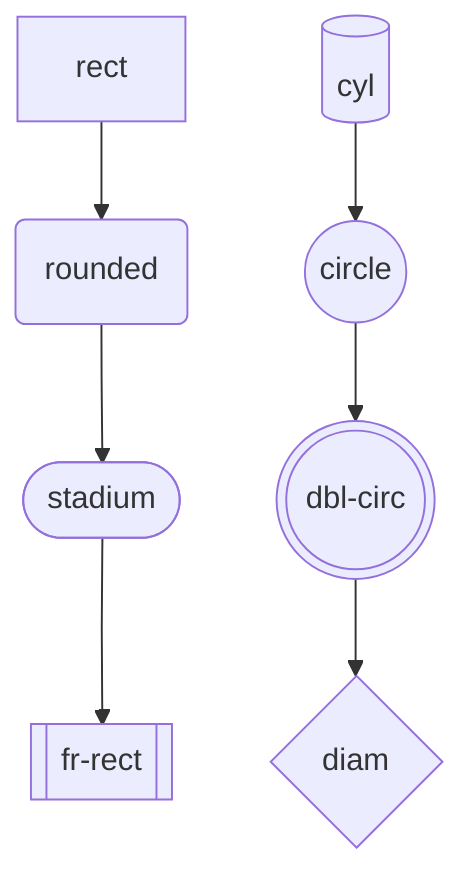
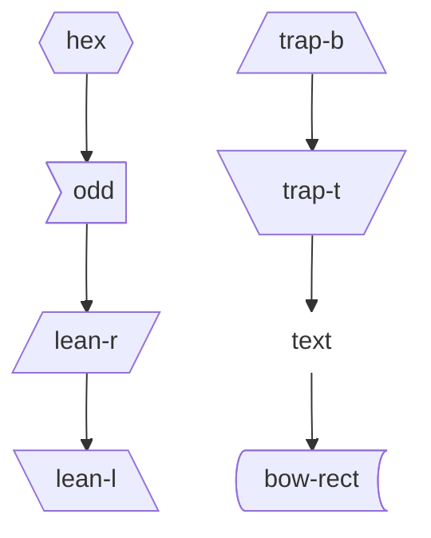
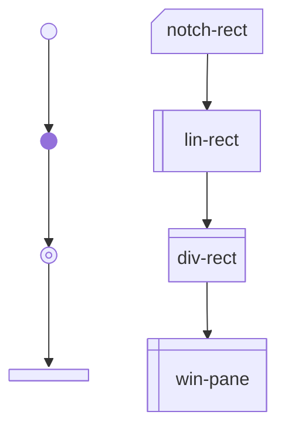
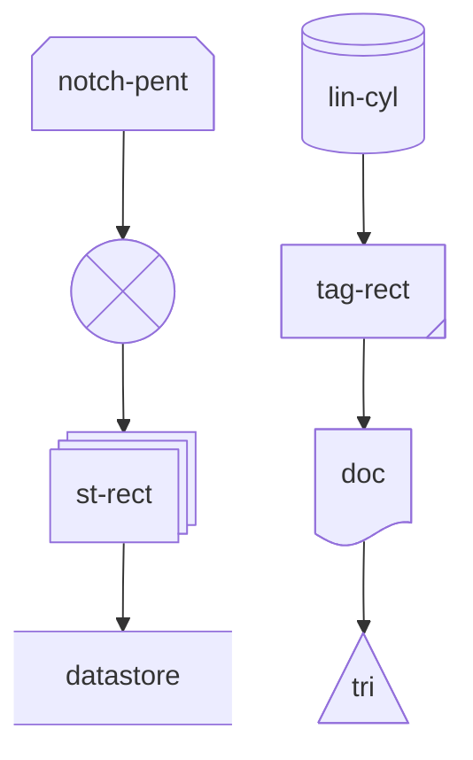
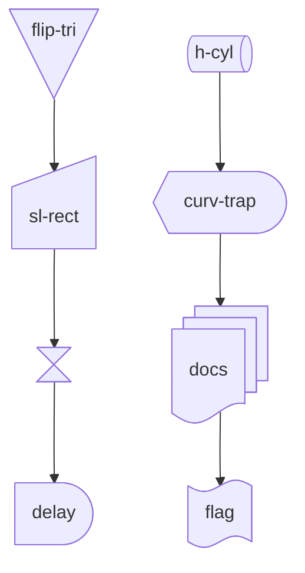
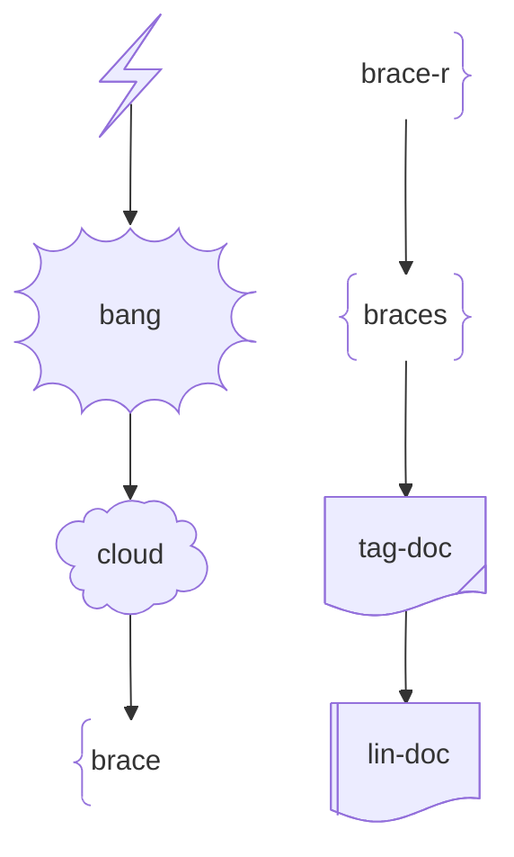

# Pele gallery

> Documentation index: [llms.min.txt](https://www.shoalrun.com/llms.min.txt) · Document manifest: [documents.json](https://www.shoalrun.com/documents.json)

Navigation section: [Examples](https://www.shoalrun.com/.well-known/shoalrun/navigation/examples-tab-50f26fe22670.txt) (ID: examples-tab). [All sections and pages](https://www.shoalrun.com/llms.min.txt)

Breadcrumbs: [Examples](https://www.shoalrun.com/config/examples.md) > Visual examples > Pele gallery

**Updated: 2026-10-26.**

Parent page: [Full Markdown page](/author/components/diagrams/pele-gallery.md)

Browse examples of Pele's 33 built-in diagram families, including its version display, and 48 flowchart shapes. Every example uses Shoalrun's [Diagram component](https://www.shoalrun.com/author/components/diagrams.md) with Mermaid syntax. These illustrate notation; they do not describe live services or measured product results.

Open **Source** beneath a diagram to copy its syntax. See [Pele's examples](https://pele.run/examples) for more variations and [compatibility notes](https://pele.run/compatibility) for differences from Mermaid.

## Flowchart shapes

These sheets show the shape names accepted by Mermaid’s extended node syntax. Each sheet connects eight shapes in two columns.

### Flowchart shapes 1

Compare rect, rounded, stadium, fr-rect, cyl, circle, dbl-circ, diam.

**Flowchart shapes 1**

Compare rect, rounded, stadium, fr-rect, cyl, circle, dbl-circ, diam.

[View Flowchart shapes 1 diagram](https://www.shoalrun.com/assets/diagrams/mermaid-0d9861176e52b1671c3f-light.svg)

### Source: Flowchart shapes 1

### Flowchart shapes 2

Compare hex, odd, lean-r, lean-l, trap-b, trap-t, text, bow-rect.

**Flowchart shapes 2**

Compare hex, odd, lean-r, lean-l, trap-b, trap-t, text, bow-rect.

[View Flowchart shapes 2 diagram](https://www.shoalrun.com/assets/diagrams/mermaid-f730aac749f3c67db89c-light.svg)

### Source: Flowchart shapes 2

### Flowchart shapes 3

Compare sm-circ, f-circ, fr-circ, fork, notch-rect, lin-rect, div-rect, win-pane.

**Flowchart shapes 3**

Compare sm-circ, f-circ, fr-circ, fork, notch-rect, lin-rect, div-rect, win-pane.

[View Flowchart shapes 3 diagram](https://www.shoalrun.com/assets/diagrams/mermaid-df98ced61cd6e22a57d4-light.svg)

### Source: Flowchart shapes 3

### Flowchart shapes 4

Compare notch-pent, cross-circ, st-rect, datastore, lin-cyl, tag-rect, doc, tri.

**Flowchart shapes 4**

Compare notch-pent, cross-circ, st-rect, datastore, lin-cyl, tag-rect, doc, tri.

[View Flowchart shapes 4 diagram](https://www.shoalrun.com/assets/diagrams/mermaid-24bd98b3f8a615e56e35-light.svg)

### Source: Flowchart shapes 4

### Flowchart shapes 5

Compare flip-tri, sl-rect, hourglass, delay, h-cyl, curv-trap, docs, flag.

**Flowchart shapes 5**

Compare flip-tri, sl-rect, hourglass, delay, h-cyl, curv-trap, docs, flag.

[View Flowchart shapes 5 diagram](https://www.shoalrun.com/assets/diagrams/mermaid-90ad759794fd78e2827e-light.svg)

### Source: Flowchart shapes 5

### Flowchart shapes 6

Compare bolt, bang, cloud, brace, brace-r, braces, tag-doc, lin-doc.

**Flowchart shapes 6**

Compare bolt, bang, cloud, brace, brace-r, braces, tag-doc, lin-doc.

[View Flowchart shapes 6 diagram](https://www.shoalrun.com/assets/diagrams/mermaid-3ccccdf2e0fb678a7fc0-light.svg)

### Source: Flowchart shapes 6

