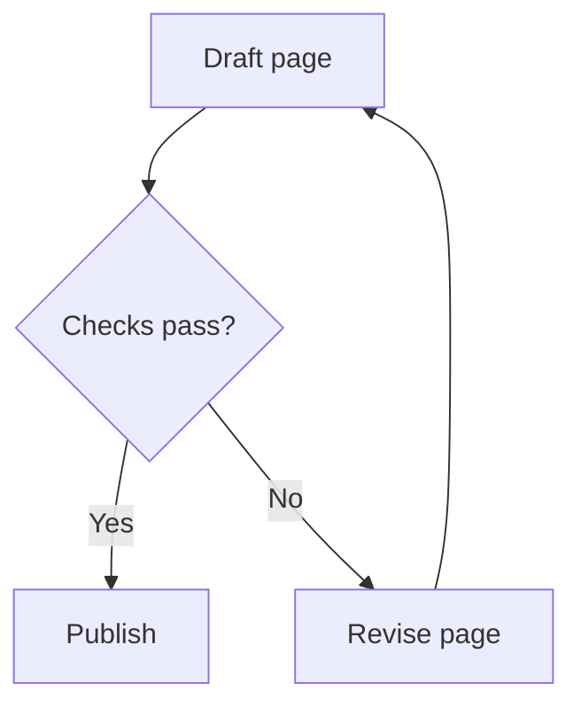
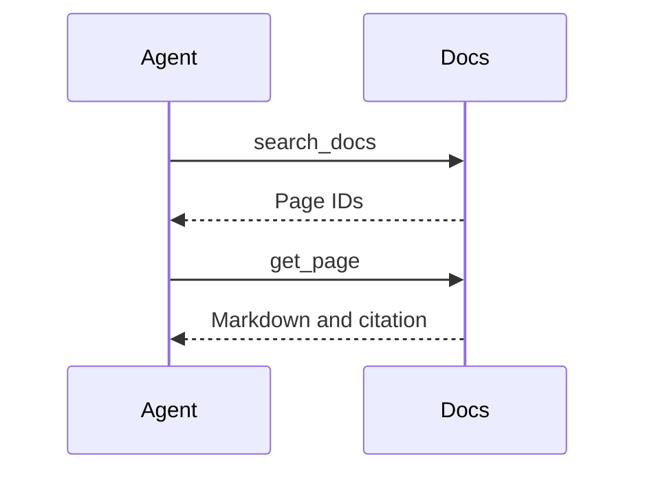
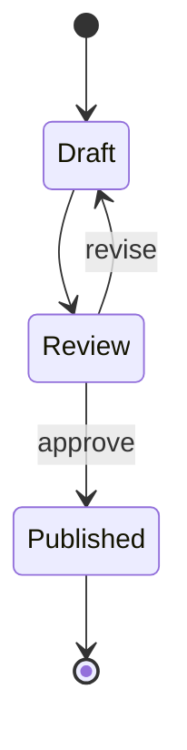
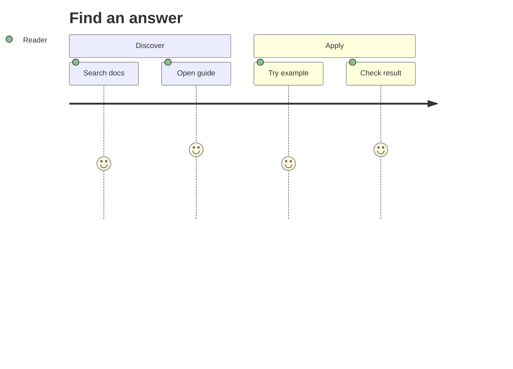
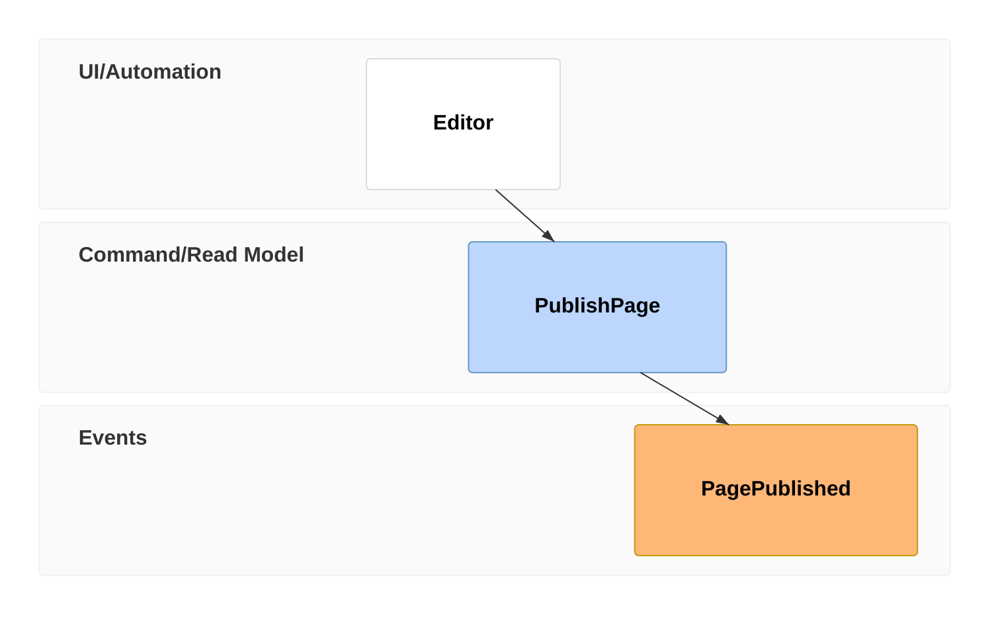

# Pele gallery

> Documentation index: [llms.min.txt](https://www.shoalrun.com/llms.min.txt) · Document manifest: [documents.json](https://www.shoalrun.com/documents.json)

Navigation section: [Docs](https://www.shoalrun.com/.well-known/shoalrun/navigation/docs-50f26fe22670.txt) (ID: docs). [All sections and pages](https://www.shoalrun.com/llms.min.txt)

Breadcrumbs: [Docs](https://www.shoalrun.com/what-is-shoalrun.md) > Write documentation > Components > Diagrams > Pele gallery

**Updated: 2026-10-26.**

Parent page: [Full Markdown page](/author/components/diagrams/pele-gallery.md)

Browse examples of Pele's 33 built-in diagram families, including its version display, and 48 flowchart shapes. Every example uses Shoalrun's [Diagram component](https://www.shoalrun.com/author/components/diagrams.md) with Mermaid syntax. These illustrate notation; they do not describe live services or measured product results.

Open **Source** beneath a diagram to copy its syntax. See [Pele's examples](https://pele.run/examples) for more variations and [compatibility notes](https://pele.run/compatibility) for differences from Mermaid.

## Flows and behavior

### Flowchart

Follow decisions and retry paths.

**Flowchart**

Follow decisions and retry paths.

[View Flowchart diagram](https://www.shoalrun.com/assets/diagrams/mermaid-01bf063c511f0148eaf3-light.svg)



### Source: Flowchart


### Sequence

Trace messages between an agent and documentation tools.

**Sequence**

Trace messages between an agent and documentation tools.

[View Sequence diagram](https://www.shoalrun.com/assets/diagrams/mermaid-c8435890ac77644550f4-light.svg)



### Source: Sequence


### State

Explain a document lifecycle.

**State**

Explain a document lifecycle.

[View State diagram](https://www.shoalrun.com/assets/diagrams/mermaid-4bf34eecf23a18a481f4-light.svg)



### Source: State


### Agentflow

Show agent tasks and decisions.

**Agentflow**

Show agent tasks and decisions.

[View Agentflow diagram](https://www.shoalrun.com/assets/diagrams/mermaid-10f5be0bd12d01559e8a-light.svg)

```mermaid
agentflow-beta TB
 draft["Draft guide"]@{ shape: task }
 check["Checks pass?"]@{ shape: decision }
 publish["Publish guide"]@{ shape: action }
 draft --> check
 check -- yes --> publish
 check -- no --> draft
```

### Source: Agentflow

```mermaid
agentflow-beta TB
 draft["Draft guide"]@{ shape: task }
 check["Checks pass?"]@{ shape: decision }
 publish["Publish guide"]@{ shape: action }
 draft --> check
 check -- yes --> publish
 check -- no --> draft
```

### Swimlane

Separate work by team.

**Swimlane**

Separate work by team.

[View Swimlane diagram](https://www.shoalrun.com/assets/diagrams/mermaid-1c54ec86ada1acf56cad-light.svg)

```mermaid
swimlane-beta LR
 subgraph Authors
  draft[Draft guide]
 end
 subgraph Reviewers
  review[Review guide]
 end
 draft --> review
```

### Source: Swimlane

```mermaid
swimlane-beta LR
 subgraph Authors
  draft[Draft guide]
 end
 subgraph Reviewers
  review[Review guide]
 end
 draft --> review
```

### User journey

Show the stages and participants in a reader journey.

**User journey**

Show the stages and participants in a reader journey.

[View User journey diagram](https://www.shoalrun.com/assets/diagrams/mermaid-c00b03674141fa1e9fa1-light.svg)



### Source: User journey


### Event modeling

Trace interface actions and resulting events.

**Event modeling**

Trace interface actions and resulting events.

[View Event modeling diagram](https://www.shoalrun.com/assets/diagrams/mermaid-7e5670e2a62a648b2f63-light.svg)



### Source: Event modeling


### Use case

Connect an actor to a supported action.

**Use case**

Connect an actor to a supported action.

[View Use case diagram](https://www.shoalrun.com/assets/diagrams/mermaid-e9ae1890e68f4da28948-light.svg)

```mermaid
usecase-beta
 actor Reader
 Browse[Browse documentation]
 Search[Search documentation]
 Reader --> Browse
 Reader --> Search
```

### Source: Use case

```mermaid
usecase-beta
 actor Reader
 Browse[Browse documentation]
 Search[Search documentation]
 Reader --> Browse
 Reader --> Search
```
