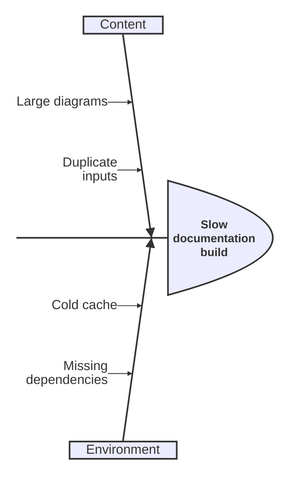
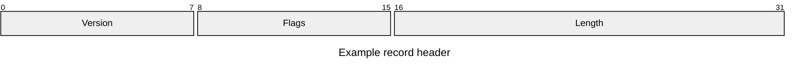
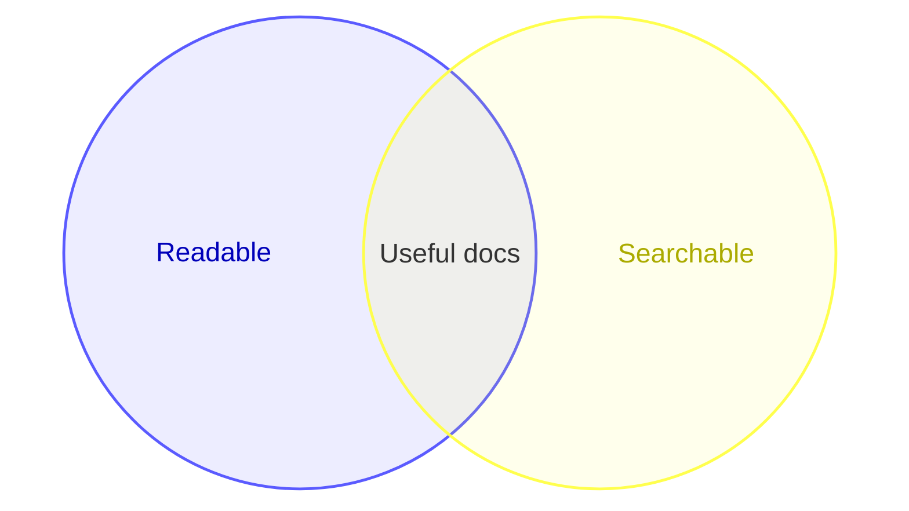

# Pele gallery

> Documentation index: [llms.min.txt](https://www.shoalrun.com/llms.min.txt) · Document manifest: [documents.json](https://www.shoalrun.com/documents.json)

Navigation section: [Docs](https://www.shoalrun.com/.well-known/shoalrun/navigation/docs-50f26fe22670.txt) (ID: docs). [All sections and pages](https://www.shoalrun.com/llms.min.txt)

Breadcrumbs: [Docs](https://www.shoalrun.com/what-is-shoalrun.md) > Write documentation > Components > Diagrams > Pele gallery

**Updated: 2026-10-19.**

Parent page: [Full Markdown page](/author/components/diagrams/pele-gallery.md)

Browse examples of Pele's 33 built-in diagram families, including its version display, and 48 flowchart shapes. Every example uses Shoalrun's [Diagram component](https://www.shoalrun.com/author/components/diagrams.md) with Mermaid syntax. These illustrate notation; they do not describe live services or measured product results.

Open **Source** beneath a diagram to copy its syntax. See [Pele's examples](https://pele.run/examples) for more variations and [compatibility notes](https://pele.run/compatibility) for differences from Mermaid.

## Specialized diagrams

### Cynefin

Group decisions by their operating context.

**Cynefin**

Group decisions by their operating context.

[View Cynefin diagram](https://www.shoalrun.com/assets/diagrams/mermaid-3ac08e0ce15b0be58045-light.svg)

```mermaid
cynefin-beta
 title Documentation decisions
 complex
  "Test new navigation"
 complicated
  "Review API coverage"
 clear
  "Fix broken link"
 chaotic
  "Restore unavailable site"
```

### Source: Cynefin

```mermaid
cynefin-beta
 title Documentation decisions
 complex
  "Test new navigation"
 complicated
  "Review API coverage"
 clear
  "Fix broken link"
 chaotic
  "Restore unavailable site"
```

### Wardley map

Relate a reader need to supporting capabilities.

**Wardley map**

Relate a reader need to supporting capabilities.

[View Wardley map diagram](https://www.shoalrun.com/assets/diagrams/mermaid-6c727aa91f970174ef39-light.svg)

```mermaid
wardley-beta
 title Documentation capabilities
 anchor Reader [0.95, 0.80]
 component Guides [0.70, 0.55]
 component Hosting [0.30, 0.90]
 Reader -> Guides
 Guides -> Hosting
```

### Source: Wardley map

```mermaid
wardley-beta
 title Documentation capabilities
 anchor Reader [0.95, 0.80]
 component Guides [0.70, 0.55]
 component Hosting [0.30, 0.90]
 Reader -> Guides
 Guides -> Hosting
```

### Ishikawa

Organize possible causes of a problem.

**Ishikawa**

Organize possible causes of a problem.

[View Ishikawa diagram](https://www.shoalrun.com/assets/diagrams/mermaid-b76432c5a764f64d4b7e-light.svg)



### Source: Ishikawa


### Packet

Describe a small binary record layout.

**Packet**

Describe a small binary record layout.

[View Packet diagram](https://www.shoalrun.com/assets/diagrams/mermaid-05b44617b4597865c1b5-light.svg)



### Source: Packet


### Railroad

Describe a small grammar using EBNF.

**Railroad**

Describe a small grammar using EBNF.

[View Railroad diagram](https://www.shoalrun.com/assets/diagrams/mermaid-a1113e4926b9ac3fce4f-light.svg)

```mermaid
railroad-ebnf-beta
 name = "guide" | "reference" ;
 command = "read", name ;
```

### Source: Railroad

```mermaid
railroad-ebnf-beta
 name = "guide" | "reference" ;
 command = "read", name ;
```

### Venn

Show overlapping sets of requirements.

**Venn**

Show overlapping sets of requirements.

[View Venn diagram](https://www.shoalrun.com/assets/diagrams/mermaid-dfe4d120d6bd5a8af4c1-light.svg)



### Source: Venn


### Renderer information

Display the renderer version as an informational diagram.

**Renderer information**

Display the renderer version as an informational diagram.

[View Renderer information diagram](https://www.shoalrun.com/assets/diagrams/mermaid-26d147f9c6a7ee30fbd4-light.svg)

```mermaid
info
```

### Source: Renderer information

```mermaid
info
```
