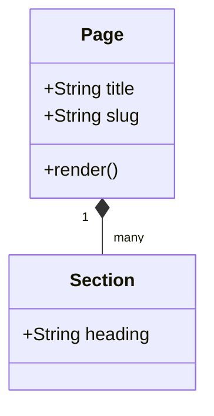
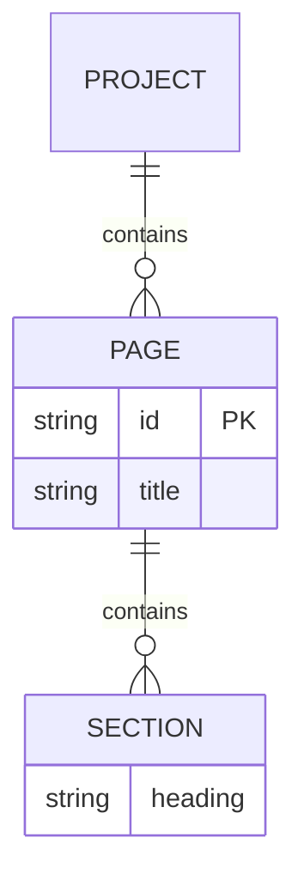
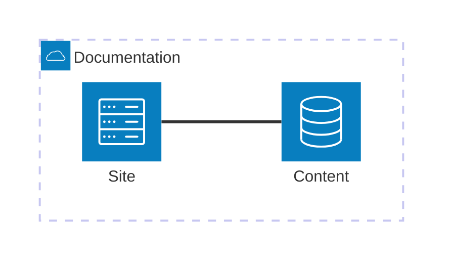
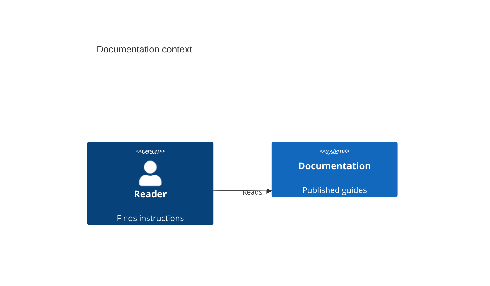
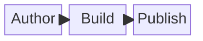
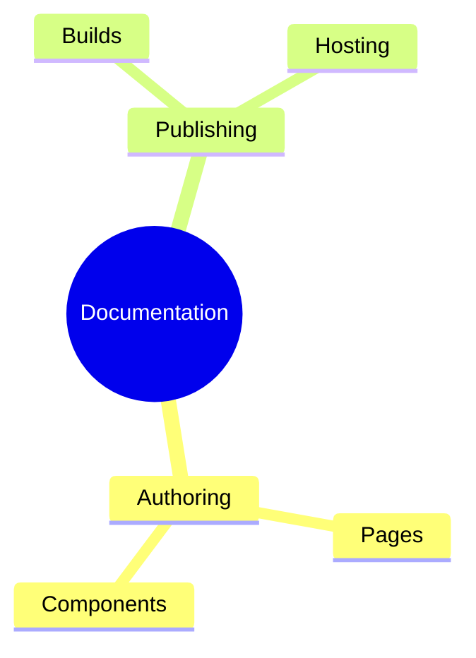
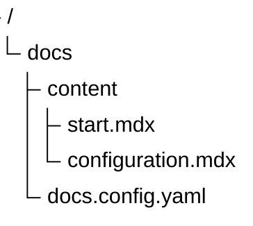
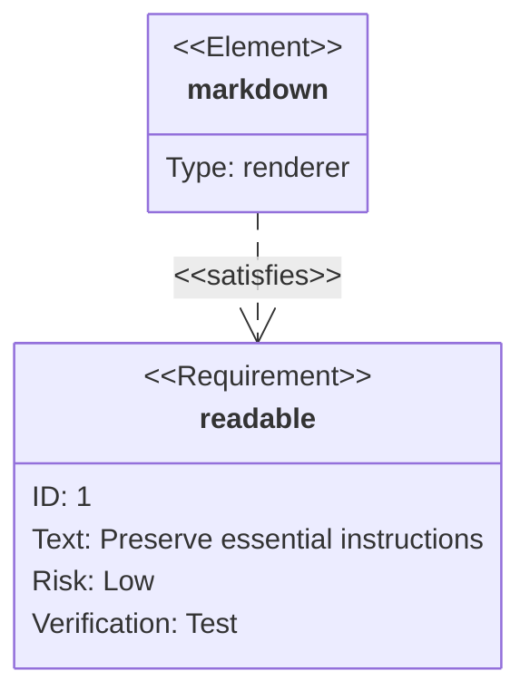

# Pele gallery

> Documentation index: [llms.min.txt](https://www.shoalrun.com/llms.min.txt) · Document manifest: [documents.json](https://www.shoalrun.com/documents.json)

Navigation section: [Docs](https://www.shoalrun.com/.well-known/shoalrun/navigation/docs-50f26fe22670.txt) (ID: docs). [All sections and pages](https://www.shoalrun.com/llms.min.txt)

Breadcrumbs: [Docs](https://www.shoalrun.com/what-is-shoalrun.md) > Write documentation > Components > Diagrams > Pele gallery

**Updated: 2026-10-17.**

Parent page: [Full Markdown page](/author/components/diagrams/pele-gallery.md)

Browse examples of Pele's 33 built-in diagram families, including its version display, and 48 flowchart shapes. Every example uses Shoalrun's [Diagram component](https://www.shoalrun.com/author/components/diagrams.md) with Mermaid syntax. These illustrate notation; they do not describe live services or measured product results.

Open **Source** beneath a diagram to copy its syntax. See [Pele's examples](https://pele.run/examples) for more variations and [compatibility notes](https://pele.run/compatibility) for differences from Mermaid.

## Systems and structures

### Class

Describe types, fields, and relationships.

**Class**

Describe types, fields, and relationships.

[View Class diagram](https://www.shoalrun.com/assets/diagrams/mermaid-af73adf46c1d18e97da9-light.svg)

### Source: Class

### Entity relationship

Show entities and relationship cardinality.

**Entity relationship**

Show entities and relationship cardinality.

[View Entity relationship diagram](https://www.shoalrun.com/assets/diagrams/mermaid-2c935f03a00d8732c5f6-light.svg)

### Source: Entity relationship

### Architecture

Connect services using built-in symbols.

**Architecture**

Connect services using built-in symbols.

[View Architecture diagram](https://www.shoalrun.com/assets/diagrams/mermaid-2604ab6aac56722b033b-light.svg)

### Source: Architecture

### C4

Describe a system and its users at a high level.

**C4**

Describe a system and its users at a high level.

[View C4 diagram](https://www.shoalrun.com/assets/diagrams/mermaid-d31ce80c287440a978dd-light.svg)

### Source: C4

### Block

Arrange connected blocks in explicit columns.

**Block**

Arrange connected blocks in explicit columns.

[View Block diagram](https://www.shoalrun.com/assets/diagrams/mermaid-4b2a2cf39d3fe9446598-light.svg)

### Source: Block

### Mindmap

Organize related documentation topics.

**Mindmap**

Organize related documentation topics.

[View Mindmap diagram](https://www.shoalrun.com/assets/diagrams/mermaid-5132acfd3a5b749b60f6-light.svg)

### Source: Mindmap

### Tree view

Display a directory hierarchy.

**Tree view**

Display a directory hierarchy.

[View Tree view diagram](https://www.shoalrun.com/assets/diagrams/mermaid-b87a0cb8033d4ea6c61b-light.svg)

### Source: Tree view

### Requirement

Connect an implementation element to a requirement.

**Requirement**

Connect an implementation element to a requirement.

[View Requirement diagram](https://www.shoalrun.com/assets/diagrams/mermaid-9b74d503a97fb3b146ea-light.svg)

### Source: Requirement

