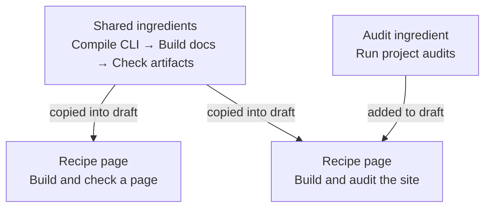

# Understand ingredients, recipes, and cookbooks

> Documentation index: [llms.min.txt](https://www.shoalrun.com/llms.min.txt) · Document manifest: [documents.json](https://www.shoalrun.com/documents.json)

Navigation section: [Docs](https://www.shoalrun.com/.well-known/shoalrun/navigation/docs-50f26fe22670.txt) (ID: docs). [All sections and pages](https://www.shoalrun.com/llms.min.txt)

Breadcrumbs: [Docs](https://www.shoalrun.com/what-is-shoalrun.md) > Write documentation > Recipes and cookbooks > Understand ingredients, recipes, and cookbooks

**Updated: 2026-10-17.**

A **recipe** is the complete page someone follows to finish a task. An **ingredient** is a reusable piece of source documentation used to write that page. A **cookbook** is a page that helps readers choose a recipe.

Readers can open a recipe directly. Ingredients help authors maintain instructions shared by several recipes. A cookbook becomes useful when readers need help choosing which complete task to follow.

## Use recipes for task-oriented how-tos

Use the built-in `how-to` template for a task page, or `recipe` when the page should participate in Shoalrun's recipe and cookbook features. Both take a reader from a known starting state to a verifiable result. Give it prerequisites, ordered actions, failure guidance, and a final success check. A recipe can be a short, directly authored page; it does not require ingredients, a YAML composition spec, or a cookbook.

Use the built-in `explanation` template to explain a concept or help readers understand a system. Use a reference page to describe fields, commands, or API behavior. Existing how-tos can keep their current type, stable ID, and route until a deliberate content revision calls for a change. A page's type does not prove its instructions have been tested.

| Writing task                                             | Starting format                          |
| -------------------------------------------------------- | ---------------------------------------- |
| Build this site and verify its output                    | A recipe.                                |
| Explain how the compiler produces HTML and Markdown      | An explanation page.                     |
| Look up CLI flags or configuration fields                | A reference page.                        |
| Reuse the same build instructions across several recipes | An ingredient included by those recipes. |
| Help a reader choose build, audit, or preview            | A cookbook pointing to complete recipes. |

The bundled `shoalrun-recipes` skill follows these choices. See [use the agent skills](https://www.shoalrun.com/contribute/agent-skills.md) for a copyable authoring request.

## One example from Shoalrun

Suppose you need two sets of instructions:

- **Build and check a page.** Compile the CLI, build the docs, and check the HTML and Markdown files.
- **Build and audit the site.** Do those same three steps, then run the project audits.

Both recipes need the same build instructions. We keep those instructions in ingredient files and use them in both recipe specs:

**Two recipes reuse the same source instructions**

The compile, build, and artifact-check ingredients are used in both recipes. The build-and-audit recipe also includes the audit ingredient. These arrows describe authoring reuse; they do not run commands.

[View Two recipes reuse the same source instructions diagram](https://www.shoalrun.com/assets/diagrams/mermaid-62592d6197a75626c36a-light.svg)

The [Site workflows cookbook](https://www.shoalrun.com/cookbooks/site-workflows.md) offers these two finished recipes. Choosing the audit path displays all four steps. The reader does not have to find or assemble the ingredients.

## What each file does

These are real files in this checkout:

| File                                       | What the author puts there                                                              | What it contributes                                                                   |
| ------------------------------------------ | --------------------------------------------------------------------------------------- | ------------------------------------------------------------------------------------- |
| `docs/content/ingredient-build-site.mdx`   | The build command, explanation, required inputs, expected outputs, and a success check. | Reusable source instructions for one step.                                            |
| `docs/recipe-specs/audit-docs.yaml`        | An ordered list of ingredient files, starting inputs, and the final goal.               | Instructions to the recipe assembler about which steps to copy and how to order them. |
| `docs/content/recipe-audit-docs.mdx`       | The assembled, reviewed recipe.                                                         | The complete page a person or agent follows.                                          |
| `docs/config/cookbooks.yaml`               | Choice labels and the published recipe ID for each option.                              | The chooser's options and descriptions.                                               |
| `docs/content/cookbook-site-workflows.mdx` | An introduction and `<CookbookChooser id="site-checks" />`.                             | The page where readers choose their task.                                             |

## What happens, and when

1. **An author prepares ingredients and a recipe spec.** Ingredients contain prose and commands. Their optional `workflow` metadata names the values or artifacts each step needs and produces.
2. **The author runs `recipe draft`.** The assembler copies ingredient bodies into a new MDX draft, combines identical prerequisites, and writes the declared handoffs and checks. It checks that each named input is available from setup or an earlier step.
3. **The author reviews and tests the recipe, then publishes it.** A normal site build turns the recipe page into HTML and Markdown. It also builds the cookbook page and its choice list.
4. **A reader chooses a recipe in the cookbook.** The browser fetches the already-published recipe and displays its instructions. The reader or their agent runs the commands and checks the results.

**Selecting a cookbook option does not assemble ingredients or run a task.** It loads finished recipe content. The cookbook's own introduction and choice descriptions come from its page and configuration.

## What changing an ingredient updates

A generated recipe is a snapshot of its ingredients. Editing an ingredient does not immediately change a published recipe. Regenerate the affected recipe, review the changes, and rebuild the site.

Shoalrun's five repository recipes have a maintenance script that updates their snapshots together and a test that detects stale snapshots. The [composition guide](https://www.shoalrun.com/author/recipe-drafts.md) shows that workflow. Other projects can keep generated recipes as drafts and edit them independently.

For example, if the docs build command changes, update the build ingredient once and regenerate the recipes that use it. The cookbook continues pointing to the same published recipe IDs.

## How agents use this

Give an agent the source material that matches its task and the outcome you want.

| Agent task                      | What to give it                                                 | What these files help it do                                                             |
| ------------------------------- | --------------------------------------------------------------- | --------------------------------------------------------------------------------------- |
| Write or maintain documentation | Ingredient source files, the recipe spec, and project evidence. | Reuse instructions and prepare consistent recipe drafts.                                |
| Complete a task                 | The finished recipe's Markdown.                                 | Follow the commands, pass values between steps, and evaluate the stated success checks. |
| Choose a task                   | The cookbook's Markdown.                                        | Read each option's purpose and follow the appropriate recipe link.                      |

The recipe assembler does not call a model. It does not execute commands, validate data types, or prove that a task succeeded. A declared output such as `builtSite` is a name and description; it does not create a directory or a shell variable. The recipe's commands produce the actual result.

A recipe's **Read as Markdown** link contains its complete published instructions. A cookbook's Markdown lists the choices and recipe links. The browser selection has no separate published Markdown endpoint. **Download Markdown** saves the selected recipes' instructions in a file you can give to an agent.

## Try a complete workflow

Use the [Authoring workflows cookbook](https://www.shoalrun.com/cookbooks/authoring.md) to add a guide, preview a change, or refresh the agent bundle in this repository. Each choice is a complete recipe with its own setup and final check.

The [email example](https://www.shoalrun.com/cookbooks/welcome-email.md) demonstrates passing a returned message ID into a delivery check. It runs against a local simulator and sends no email.

## Related reading

### Next steps

- [Compose and maintain recipes](https://www.shoalrun.com/author/recipe-drafts.md) — Follow the actual ingredient files and spec that produce Shoalrun's audit recipe.

- [Authoring workflows](https://www.shoalrun.com/cookbooks/authoring.md) — Use complete workflows for Shoalrun documentation work.

- [Welcome email workflows](https://www.shoalrun.com/cookbooks/welcome-email.md) — Try an acceptance check or follow a message ID through delivery and failure handling.
