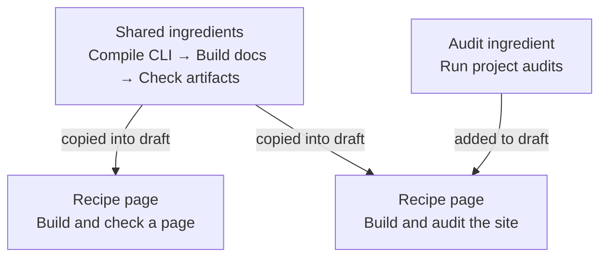

# Understand ingredients, recipes, and cookbooks

> Documentation index: [llms.min.txt](https://www.shoalrun.com/llms.min.txt) · Document manifest: [documents.json](https://www.shoalrun.com/documents.json)

Navigation section: [Docs](https://www.shoalrun.com/.well-known/shoalrun/navigation/docs-50f26fe22670.txt) (ID: docs). [All sections and pages](https://www.shoalrun.com/llms.min.txt)

Breadcrumbs: [Docs](https://www.shoalrun.com/what-is-shoalrun.md) > Write documentation > Recipes and cookbooks > Understand ingredients, recipes, and cookbooks

**Updated: 2026-10-17.**

Parent page: [Full Markdown page](/author/recipes.md)

**Page reading path** — these links apply to the full page.

**Next steps**

- [Compose and maintain recipes](https://www.shoalrun.com/author/recipe-drafts.md) — Follow the actual ingredient files and spec that produce Shoalrun's audit recipe.

- [Authoring workflows](https://www.shoalrun.com/cookbooks/authoring.md) — Use complete workflows for Shoalrun documentation work.

- [Welcome email workflows](https://www.shoalrun.com/cookbooks/welcome-email.md) — Try an acceptance check or follow a message ID through delivery and failure handling.

A **recipe** is the complete page someone follows to finish a task. An **ingredient** is a reusable piece of source documentation used to write that page. A **cookbook** is a page that helps readers choose a recipe.

Readers can open a recipe directly. Ingredients help authors maintain instructions shared by several recipes. A cookbook becomes useful when readers need help choosing which complete task to follow.

## One example from Shoalrun

Suppose you need two sets of instructions:

- **Build and check a page.** Compile the CLI, build the docs, and check the HTML and Markdown files.
- **Build and audit the site.** Do those same three steps, then run the project audits.

Both recipes need the same build instructions. We keep those instructions in ingredient files and use them in both recipe specs:

**Two recipes reuse the same source instructions**

The compile, build, and artifact-check ingredients are used in both recipes. The build-and-audit recipe also includes the audit ingredient. These arrows describe authoring reuse; they do not run commands.

[View Two recipes reuse the same source instructions diagram](https://www.shoalrun.com/assets/diagrams/mermaid-62592d6197a75626c36a-light.svg)

The [Site workflows cookbook](https://www.shoalrun.com/cookbooks/site-workflows.md) offers these two finished recipes. Choosing the audit path displays all four steps. The reader does not have to find or assemble the ingredients.
