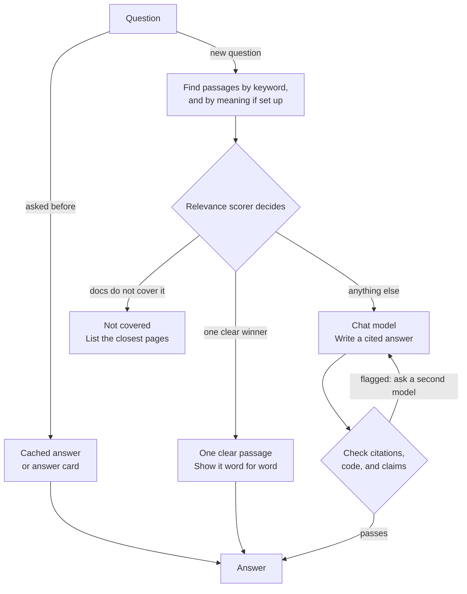

# How documentation answers work

> Documentation index: [llms.min.txt](https://www.shoalrun.com/llms.min.txt) · Document manifest: [documents.json](https://www.shoalrun.com/documents.json)

Navigation section: [Docs](https://www.shoalrun.com/.well-known/shoalrun/navigation/docs-50f26fe22670.txt) (ID: docs). [All sections and pages](https://www.shoalrun.com/llms.min.txt)

Breadcrumbs: [Docs](https://www.shoalrun.com/what-is-shoalrun.md) > Search and chat > Documentation chat > How answers work

**Updated: 2026-10-19.**

**Status: Experimental.**

Documentation chat reads a site you have already built. It is optional: a normal `shoalrun build` does not call the retrieval or chat providers.

Chat first finds relevant passages, then uses them to produce a cited answer. A passage is a short part of a built Markdown page with a link back to its source. Some configurations can return an existing answer or an excerpt instead of generating new text.

For commands, start with [local chat setup](https://www.shoalrun.com/chat/setup.md). [Search and chat](https://www.shoalrun.com/search-and-chat.md) compares chat with the page-search box.

## How the layers fit

Each layer adds a retrieval or answer capability and has its own prerequisites.

| Layer            | What it adds                                                                                                                                                               | It needs                                       |
| ---------------- | -------------------------------------------------------------------------------------------------------------------------------------------------------------------------- | ---------------------------------------------- |
| Keyword matching | Finds the most relevant passages by their words. It is what the chat uses when there are no vectors, or the embedding service is unavailable.                              | The passage index. No key.                     |
| Semantic search  | Finds passages by meaning, so a question matches even when it shares no words with the page.                                                                               | An embedding service and key.                  |
| Relevance scorer | Reorders the results and declines a question the docs don't cover. It checks each sentence of an answer, and shows a passage word for word when one is clearly the answer. | A scorer service that speaks the Jev protocol. |
| Chat model       | Writes a cited answer from the best passages.                                                                                                                              | A chat service and key.                        |
| Hosting          | Runs the chat beside your site with spending caps and an off switch.                                                                                                       | Vercel, and a key-value store.                 |

The site-search box returns links from its own page index. Chat retrieves passages to answer a question. An embedding service helps match different wording; a scorer rates whether the passages support an answer. The [settings reference](https://www.shoalrun.com/chat/settings.md) describes supported providers and the Jev scoring protocol.

Choose services and models in config. Keep their keys in the environment variables named by that config.

## How a question is answered

The diagram shows a chat with optional reuse and scoring enabled. A question stops at an existing answer or direct excerpt when the configured checks accept one.

**How a question is answered**

A question first looks for a cached answer or an answer card. Otherwise passages are found by keyword and meaning, and the relevance scorer decides. A question the docs don't cover gets a list of pages. One clear passage is shown as an excerpt. Everything else goes to the chat model, whose answer is checked before it is shown.

[View How a question is answered diagram](https://www.shoalrun.com/assets/diagrams/mermaid-78c5e9dba3d9234c8040-light.svg)

The minimal setup uses keyword retrieval, a chat model, and citation and code checks. Caching, answer cards, scoring, and claim verification need extra configuration. Without a scorer, there is no score-based coverage gate.

For an explicit request with up to three action clauses, retrieval can find evidence for each part and include page introductions. This helps keep one topic from filling the passage budget. [Answer checks](https://www.shoalrun.com/chat/checks.md) explains that behavior and its limits.

## Put the model into practice

Add optional layers after testing the minimal setup with questions your readers actually ask. Check source coverage and response quality before choosing scoring thresholds or enabling answer reuse.

Use [set up local documentation chat](https://www.shoalrun.com/chat/setup.md) for commands and verification. The [retrieval and chat settings](https://www.shoalrun.com/chat/settings.md) define provider fields and defaults. [Passage index](https://www.shoalrun.com/chat/passage-index.md) describes the files used by retrieval.

## Related reading

### Next steps

- [Passage index](https://www.shoalrun.com/chat/passage-index.md) — See how a built site is split into passages and embedded. (Status: experimental.)

- [Check and speed up answers](https://www.shoalrun.com/chat/checks.md) — Decline questions the docs don't cover and check what the model writes. (Status: experimental.)

- [Host and limit documentation chat](https://www.shoalrun.com/chat/host.md) — Run the chat beside your site with spending caps and an off switch. (Status: experimental.)

### Reference while working

- [CLI reference](https://www.shoalrun.com/cli.md) — Look up the index, ask, answers, ask-log, chat, and serve commands.

- [Retrieval and chat settings](https://www.shoalrun.com/chat/settings.md) — Look up every retrieval and chat setting. (Status: experimental.)

### Related topics

- [Set up local documentation chat](https://www.shoalrun.com/chat/setup.md) — Understand the layers behind cited answers before choosing additional services. (Status: experimental.)

- [Site search](https://www.shoalrun.com/author/search.md) — Use retrieved passages to produce cited answers instead of page links.
