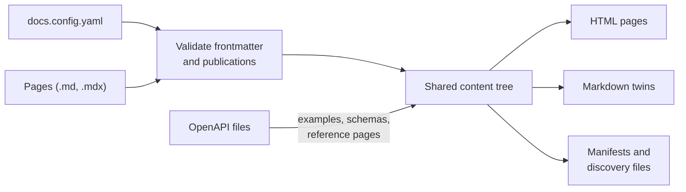

# How Shoalrun works

> Documentation index: [llms.min.txt](https://www.shoalrun.com/llms.min.txt) · Document manifest: [documents.json](https://www.shoalrun.com/documents.json)

Navigation section: [Docs](https://www.shoalrun.com/.well-known/shoalrun/navigation/docs-50f26fe22670.txt) (ID: docs). [All sections and pages](https://www.shoalrun.com/llms.min.txt)

Breadcrumbs: [Docs](https://www.shoalrun.com/what-is-shoalrun.md) > Get started > How Shoalrun works

**Updated: 2026-10-17.**

Shoalrun is a static documentation compiler. It reads a project config, Markdown and MDX pages, and local OpenAPI files. It writes an HTML site and a Markdown copy of every page. A build makes no network requests and no model calls, so the same inputs always give the same output.

## Choose your focus

Pick a path to narrow the site's navigation and search. The choice persists across visits; **All** in the header shows every page again. Both paths keep foundational guides like this one visible.

[Write documentation](https://www.shoalrun.com/concepts?view=focus%3Awrite)

[Configure & publish](https://www.shoalrun.com/concepts?view=focus%3Aconfigure)

**For Focus: Write documentation.**

Start with [adding a page](https://www.shoalrun.com/author/add-page.md), then use [page metadata](https://www.shoalrun.com/author/frontmatter.md) and [components](https://www.shoalrun.com/author/components.md) to shape it.

**For Focus: Configure & publish.**

Start with [project configuration](https://www.shoalrun.com/configuration.md), then explore [themes](https://www.shoalrun.com/styling/themes.md) and [publishing](https://www.shoalrun.com/publish.md).

## The build pipeline

**Shoalrun build pipeline**

Config and sources pass through validation and one shared content tree, which produces HTML pages, Markdown twins, and manifests.

[View Shoalrun build pipeline diagram](https://www.shoalrun.com/assets/diagrams/mermaid-98a388873e52f66c5f05-light.svg)

1. **Load config.** The build reads `docs.config.yaml` and every file it includes or extends. Unknown top-level keys fail. See the [configuration reference](https://www.shoalrun.com/config.md).
2. **Read pages.** Every `.md` and `.mdx` file in the content directory is parsed, and its frontmatter is merged with project defaults and checked. Drafts are checked too.
3. **Choose publications.** A public page can name one publication or list several. One source file can therefore produce several page variants, with optional version-specific sections. Write separate files only when the pages need substantially different content.
4. **Build the content tree.** MDX components, snippets, `doc:` links, cards, API embeds, and diagrams become one shared tree. Generated API reference pages join here.
5. **Render.** The same tree produces the HTML page and its Markdown twin, so the two can't drift apart. Diagrams are rendered to SVG at this step: D2 and Pele both run in-process, without a browser.
6. **Write the site.** The build writes pages, assets, API contracts, and manifests. See [published outputs](https://www.shoalrun.com/publish/output.md).

## Identity: IDs, slugs, and routes

A page has a stable **ID**, such as `guide.concepts`, and a **slug**, such as `/concepts`. Links, cards, navigation, and relationships use the ID, so you can rename a file or change a slug without breaking them. The slug sets the URL path, so changing a slug changes the URL. Add a [redirect](https://www.shoalrun.com/config.md) from the old path if readers or other sites link to it.

The **route** is the final URL. It combines `site.basePath`, a language prefix for a non-default language, the channel's and version's `pathPrefix`, and the slug. For example, a German page at `/guides/retry` in a `v2` version with `pathPrefix: /v2` has the route `/de/v2/guides/retry`.

API operations have three identifiers:

| Identifier           | Example                 | Where it comes from                                     |
| -------------------- | ----------------------- | ------------------------------------------------------- |
| Source `operationId` | `createNote`            | The OpenAPI file.                                       |
| Stable operation ID  | `notes.create`          | Your `apis` config. Pages and navigation refer to this. |
| Reference page ID    | `reference.create-note` | The page that presents the operation.                   |

The stable operation ID keeps pages linked even if the OpenAPI `operationId` changes. See [API references](https://www.shoalrun.com/publish/api-references.md).

## Publications

A **publication** is one enabled combination of channel, version, and language:

- A **channel** is an audience or environment, such as `production` or `sandbox`.
- A **version** is an API or documentation edition, such as `v1` or `current`.
- A **language** is a content language, such as `en`.

`publications.enabled` lists the combinations to build. A page's frontmatter picks one or several of them; files for other versions or languages can share its `id`. Links, cards, and related reading stay inside the current publication, so a v1 page never links to a v2 page by accident. Each published copy of a page is a **variant**. The HTML and Markdown copy for each variant include only content selected for that publication.

Git branches and tags select source revisions for a build; they do not select publication channels or preserve earlier deployed sites. The [deployment and version guide](https://www.shoalrun.com/publish/revisions.md) explains how those choices fit together.

For a complete versioning and translation workflow, follow [put multiple versions on one site](https://www.shoalrun.com/publish/publications.md).

## Drafts and publishing

Only pages with `access.policy: public` are published. Anything else, such as `draft`, is still validated but never written to the site. New pages from `shoalrun scaffold` start as drafts with placeholder prompts. A public page fails the build until every placeholder is replaced. See [templates](https://www.shoalrun.com/author/templates.md).

## Config composition

A project config can be one file or many. Four directives combine files:

- `$include` replaces a value with the contents of another YAML file.
- `extends` layers the current file over one or more preset files.
- `$concat` appends to a list inherited from a preset.
- `$remove` drops inherited map keys or list items by `id`.

`shoalrun config explain <key>` reports which file set a value. Follow [configure your project](https://www.shoalrun.com/configuration.md) for a worked example of composition, precedence, file paths, and debugging.

## Glossary

Terms such as **publication**, **variant**, **Markdown twin**, and **focused contract** are defined in the [glossary](https://www.shoalrun.com/glossary.md). It lists more than a hundred terms, sorted A to Z, and links each one to its guide.

## Related reading

### Next steps

- [Organize project configuration](https://www.shoalrun.com/configuration.md) — Compose your project settings and trace how they resolve.

- [Content and stable IDs](https://www.shoalrun.com/author/content.md) — Apply IDs, slugs, and publication variants to your own pages.

### Reference while working

- [Configuration reference](https://www.shoalrun.com/config.md) — Check every top-level setting the build reads.

- [Glossary](https://www.shoalrun.com/glossary.md) — Look up any term used on this page, and more than a hundred others.

- [Publishing and agent representations](https://www.shoalrun.com/publish/output.md) — Find each HTML, Markdown, and manifest file the pipeline writes.

### Related topics

- [Getting started](https://www.shoalrun.com/start.md) — Learn the build pipeline and the terms the rest of these docs use.
